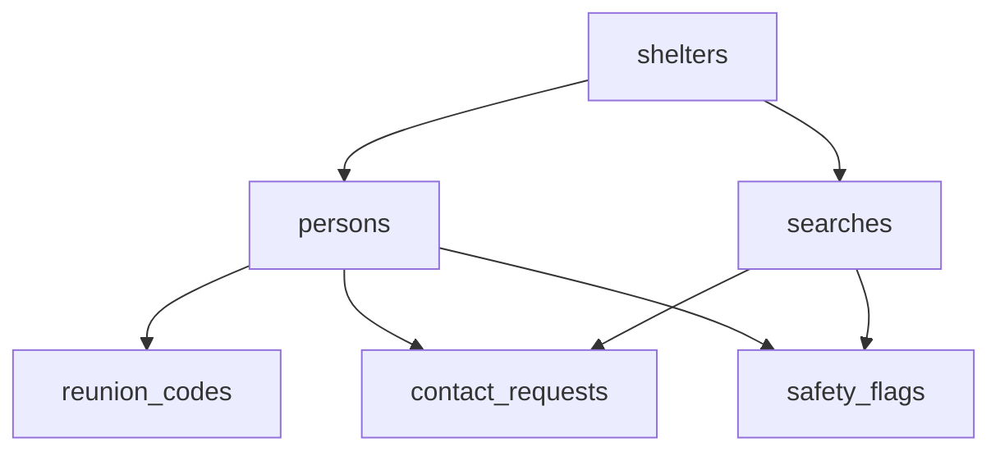

# Database choice: PostgreSQL (on Neon)

## TL;DR

**PostgreSQL** with the **`pg_trgm`** (similar spelling), **`fuzzystrmatch`** (sounds alike) and **`unaccent`** ("José" = "Jose") extensions, hosted on **Neon**, with the schema in **Flyway** migrations.

The backend already guards the privacy rules. But code has bugs, so the database was chosen by one question:

> **Which database can enforce the privacy rules by itself, even if the app has a bug?**

1. **The hardest rules live in the database too.** A trigger refuses to connect a flagged person or release a child without a lead, even if the Kotlin check is skipped. A new flag also blocks anything that was already revealed.
2. **Fuzzy name matching is built in.** "Katherine Rodrigez" finds "Catherine Rodriguez" with plain SQL, no extra search service.
3. **Permissions per table and per column.** The app's database user can add to the audit log but never change or delete it, and it can lift a safety flag but never rewrite what the flag is about.

**What the database enforces, and what it doesn't:**

| The database enforces (even if the app has a bug) | The backend enforces (the database can't know) |
| --- | --- |
| Valid values (`CHECK`), safe defaults, no ID columns | *Who* is logged in, and that the approver is really that person |
| Flags and child rules on every "Connect" or "safe" | Which shelter a volunteer may read (the app user can read all rows) |
| Hidden and protected people never come out of matching | That matching code only reads `search_candidates` |
| Audit log and edit history can't be changed or faked | That every action actually writes an audit entry |

---

## Options I compared

| Option | Good at | Weak for *this* problem |
| --- | --- | --- |
| **PostgreSQL** ✅ | Trigram + sound-alike matching, CHECK rules, triggers, views, per-table and per-column permissions; relational data | I write and maintain the SQL myself |
| MySQL | Very widely used, fast, relational, triggers and grants | No trigram similarity or Double Metaphone built in; only `SOUNDEX` (English-only, weak) for sound-alike names |
| MongoDB | Flexible documents, generous free tier (Atlas) | Fuzzy search needs Atlas Search (a separate index, no sound-alike); people ↔ searches ↔ requests are linked by hand; most rules end up in app code |

**How they score on what this problem needs:**

| Need (from the scenario) | PostgreSQL | MySQL | MongoDB |
| --- | --- | --- | --- |
| Fuzzy name matching (spelling + sound) | ✅ `pg_trgm` + `dmetaphone` in SQL | 🟡 `SOUNDEX` only | 🟡 Atlas Search, separate index |
| Safety rules enforced inside the database | ✅ CHECK, triggers, views, grants | ✅ CHECK, triggers, grants | 🟡 schema validation only |
| Free hosting that doesn't expire | ✅ Neon | 🟡 fewer good free tiers | ✅ Atlas M0 |

PostgreSQL is the only one that wins all three rows. MySQL is close on safety rules but loses on matching, which is the heart of the app.

---

## Where it's hosted

| Host | Good at | Weak for *this* problem |
| --- | --- | --- |
| **Neon** ✅ | Free tier that doesn't expire, `pg_trgm`, `fuzzystrmatch` and `unaccent` available, branches for testing | Sleeps when idle, so the first query after a break is a little slower |
| Supabase | Free Postgres plus extras (auth, auto-generated API) | Free projects pause after a week without use; the auto API could expose tables if I misconfigure it |
| Render Postgres | Same place as the backend | The free database expires after about 30 days, before the review might even happen |

---

## Requirements → SQL

The constraints come first, then the SQL that enforces each one. The SQL below is copied from the complete tested draft `server/src/main/resources/db/draft/full_schema_draft.sql`, which is being split into the Flyway migrations `V1`–`V3` step by step (see `DATABASE_PLAN.md`). It passes all checks on PostgreSQL 18.6, the same version as Neon; each rule was tested by trying to break it (see **Tests**).

| # | Constraint (from the scenario) | Enforced by |
| --- | --- | --- |
| 1 | Some people don't want to be found | `search_candidates` view, `safety_flags` + its triggers, `contact_requests_guard` trigger |
| 2 | Children are never released without a lead | `treated_as_minor()`, `contact_requests_guard` trigger |
| 3 | Many people have no phone | `reunion_codes` table |
| 4 | Many people have no ID | `persons` (only a name is required, no ID columns) |
| 5 | Each shelter keeps its own list, some on paper | `persons.id` from the browser, `source` / `paper_ref` / `recorded_at` |
| 6 | Volunteers are non-technical and exhausted | `person_history` (edit snapshots) |
| 7 | Every search and reveal is traceable | `audit_log` + insert-only, column-limited permission |

### 1. "Some people don't want to be found"

- **`search_candidates`** is the view matching reads. It has no shelter, home area, phone or description column, so a match can't carry a location. It's a `security_barrier` view, so its filters run before anything else and a clever query can't peek at the rows it removes.
- People who chose "Don't tell anyone I'm here" (`hidden`) never show up in it, **children included**, so searching their exact name gives the same answer as searching a name that doesn't exist. A guardian looking for a hidden child goes through a lead instead.
- **`safety_flags`** are about exactly one person or one search. What each kind does is in the table below.
- **`contact_requests_guard`** refuses to mark a request `connected` or `safe_only` while there's an active flag on the person, the search, or the searcher. A request can also never be moved to another person or search, and **`searches_keep_searcher`** stops a search's searcher from being swapped once it has one (or once it got an answer), so a "yes" can't be reused for someone else.
- **When a flag is added**, every request it touches that was already `connected` or `safe_only` switches to `blocked` straight away. Both triggers lock the same rows, so a flag and a "Connect" happening at the same moment can't slip past each other. A lifted flag can't be switched back on; protecting someone again means adding a new flag, which runs all of this again.

**What each flag does:**

| Flag | On a person | On a search |
| --- | --- | --- |
| `do_not_disclose` | Disappears from matching; can't be connected or told "safe"; earlier reveals blocked | Not allowed (only a person can be protected) |
| `suspected_abuser` | Their own searches can't connect; earlier reveals to them blocked | This search can't connect; earlier reveals blocked |
| `custody_hold` | Still matchable, so a lead can see them, but can't be connected or told "safe" | This search can't connect |

```sql
-- No shelter, home area, phone or description. Hidden people and protected people never show up.
-- security_barrier: the filters run first, so a clever query can't peek at the rows they remove.
CREATE VIEW search_candidates WITH (security_barrier) AS
SELECT p.id, p.preferred_name, p.other_names, p.approx_age, p.age_is_estimate,
       p.search_names, p.name_words, p.name_sounds, treated_as_minor(p) AS minor
FROM persons p
WHERE p.status <> 'left'
  AND p.visibility <> 'hidden'
  AND NOT EXISTS (SELECT 1 FROM safety_flags f
                  WHERE f.person_id = p.id AND f.cleared_at IS NULL
                    AND f.kind = 'do_not_disclose');
```

```sql
CREATE TABLE safety_flags (
    id         uuid PRIMARY KEY DEFAULT gen_random_uuid(),
    person_id  uuid REFERENCES persons(id) ON DELETE CASCADE,  -- about this person
    search_id  uuid REFERENCES searches(id) ON DELETE CASCADE, -- about this search
    kind       text NOT NULL CHECK (kind IN ('do_not_disclose', 'suspected_abuser', 'custody_hold')),
    note       text,
    created_by uuid NOT NULL REFERENCES staff(id),
    created_at timestamptz NOT NULL DEFAULT now(),
    cleared_at timestamptz,                                    -- NULL = still active
    cleared_by uuid REFERENCES staff(id),
    CHECK ((person_id IS NULL) <> (search_id IS NULL)),        -- exactly one subject
    CHECK (kind <> 'do_not_disclose' OR person_id IS NOT NULL),-- only a person can be protected
    CHECK ((cleared_at IS NULL) = (cleared_by IS NULL))        -- a lifted flag says who lifted it
);
```

```sql
CREATE TABLE contact_requests (
    id               uuid PRIMARY KEY DEFAULT gen_random_uuid(),
    search_id        uuid NOT NULL REFERENCES searches(id) ON DELETE CASCADE,
    person_id        uuid NOT NULL REFERENCES persons(id) ON DELETE CASCADE,
    state            text NOT NULL DEFAULT 'pending'
                     CHECK (state IN ('pending', 'connected', 'safe_only', 'declined', 'blocked')),
    contact_plan     text,                                     -- how to meet; only after "Connect"
    approved_by      uuid REFERENCES staff(id),                -- the lead, for a child
    guardian_checked boolean NOT NULL DEFAULT false,
    note             text,
    decided_at       timestamptz,
    created_at       timestamptz NOT NULL DEFAULT now(),
    UNIQUE (search_id, person_id),
    CHECK (state <> 'connected' OR has_text(contact_plan))     -- "connected" always says how to meet
);
```

```sql
-- A new flag locks the same rows as the guard, then blocks anything it already revealed.
CREATE FUNCTION safety_flags_block_reveals() RETURNS trigger
LANGUAGE plpgsql SET search_path = public, pg_temp AS $$
BEGIN
    UPDATE contact_requests cr
    SET state = 'blocked', decided_at = now()
    WHERE cr.state IN ('connected', 'safe_only')
      AND (cr.person_id = NEW.person_id                         -- the flagged person was revealed
           OR cr.search_id = NEW.search_id                      -- the flagged search got an answer
           OR cr.search_id IN (SELECT s.id FROM searches s      -- the flagged person was the searcher
                               WHERE s.searcher_person_id = NEW.person_id));
    RETURN NEW;
END $$;

CREATE TRIGGER safety_flags_block_reveals
    AFTER INSERT ON safety_flags
    FOR EACH ROW EXECUTE FUNCTION safety_flags_block_reveals();

-- The person searching can't be swapped once it matters: a "yes" given to one searcher
-- must never be handed to another (possibly a child, who would then skip the lead check).
CREATE FUNCTION searches_keep_searcher() RETURNS trigger
LANGUAGE plpgsql SET search_path = public, pg_temp AS $$
BEGIN
    IF NEW.searcher_person_id IS DISTINCT FROM OLD.searcher_person_id
       AND (OLD.searcher_person_id IS NOT NULL
            OR EXISTS (SELECT 1 FROM contact_requests cr
                       WHERE cr.search_id = OLD.id AND cr.state IN ('connected', 'safe_only'))) THEN
        RAISE EXCEPTION 'the person searching can''t be changed; start a new search' USING ERRCODE = 'check_violation';
    END IF;
    RETURN NEW;
END $$;

CREATE TRIGGER searches_keep_searcher
    BEFORE UPDATE OF searcher_person_id ON searches
    FOR EACH ROW EXECUTE FUNCTION searches_keep_searcher();

-- A lifted flag stays lifted: switching it back on would skip the lock and the blocking above.
-- To protect someone again, add a new flag.
CREATE FUNCTION safety_flags_no_reactivate() RETURNS trigger
LANGUAGE plpgsql AS $$
BEGIN
    IF OLD.cleared_at IS NOT NULL AND NEW.cleared_at IS NULL THEN
        RAISE EXCEPTION 'a lifted flag can''t be switched back on; add a new flag' USING ERRCODE = 'check_violation';
    END IF;
    RETURN NEW;
END $$;

CREATE TRIGGER safety_flags_no_reactivate
    BEFORE UPDATE ON safety_flags
    FOR EACH ROW EXECUTE FUNCTION safety_flags_no_reactivate();
```

A hidden person can still say yes to one specific searcher: "hidden" means "don't show me in searches", not "never let anyone reach me". The database checks the rules around a "yes" (flags, children, a contact plan), but it can't prove that a human really said it. That part is the volunteer's job, and every decision is audit-logged.

### 2. Children are never released without a lead

- **`treated_as_minor()`** decides who counts as a child. A known age always decides (under 18 = child). With no age, the person counts as a child unless a volunteer marked them as an adult.
- The table refuses contradictions: a 9-year-old can't be marked "adult", and a 40-year-old can't be marked "minor".
- **`contact_requests_guard`** checks every attempt to connect a child, **whether the child is the one being looked for or the one searching**, because "Connect" shows both sides how to reach each other. The approver must be a lead or coordinator, the guardian check must be ticked, and the note must contain real text (not just spaces).
- **`persons_recheck_minor`**: if a correction makes someone count as a child (e.g. age 40 corrected to 14), every "Connect" involving them, found or searching, that has no lead sign-off goes back to `pending` for a lead to approve.
- This is the same rule as `ConsentService.releaseMinor` in the backend. If the Kotlin check ever had a bug, the database would still say no.
- The database reads the approver's role from the `staff` table. Making sure the approver is really the person logged in is the backend's job (it takes the approver from the login).

```sql
-- Treated as a child unless we KNOW they're an adult.
-- A known age decides; with no age, only a volunteer marking "adult" (is_minor = false) makes them an adult.
CREATE FUNCTION treated_as_minor(p persons) RETURNS boolean
LANGUAGE sql IMMUTABLE AS $$
    SELECT CASE WHEN p.approx_age IS NOT NULL THEN p.approx_age < 18
                ELSE coalesce(p.is_minor, true) END
$$;
```

```sql
-- The last line of defense for connecting people.
-- search_path is pinned (pg_temp last) in every function that reads tables,
-- so a temporary table named e.g. safety_flags can't stand in for the real one.
CREATE FUNCTION contact_requests_guard() RETURNS trigger
LANGUAGE plpgsql SET search_path = public, pg_temp AS $$
DECLARE
    p persons;              -- the person being looked for
    sp persons;             -- the person searching (if registered)
    searcher uuid;
    approver_role text;
BEGIN
    -- 0. A request belongs to one search and one person forever; another pair needs a new request.
    IF TG_OP = 'UPDATE' AND (NEW.person_id <> OLD.person_id OR NEW.search_id <> OLD.search_id) THEN
        RAISE EXCEPTION 'a request can''t be moved to another person or search' USING ERRCODE = 'check_violation';
    END IF;

    IF NEW.state NOT IN ('connected', 'safe_only') THEN
        RETURN NEW;                                  -- only revealing states are checked
    END IF;

    -- Lock the rows a new flag would lock too, so a flag and a "Connect" can't slip past each other.
    SELECT * INTO p FROM persons WHERE id = NEW.person_id FOR UPDATE;
    SELECT searcher_person_id INTO searcher FROM searches WHERE id = NEW.search_id FOR UPDATE;
    IF searcher IS NOT NULL THEN
        SELECT * INTO sp FROM persons WHERE id = searcher FOR UPDATE;
    END IF;

    -- 1. Safety flags beat everything, including "findable" and an earlier "Connect":
    --    a flag on the person, on this search, or on the searcher.
    IF EXISTS (SELECT 1 FROM safety_flags f
               WHERE f.cleared_at IS NULL
                 AND (f.person_id = NEW.person_id
                      OR f.search_id = NEW.search_id
                      OR f.person_id = searcher)) THEN
        RAISE EXCEPTION 'blocked by a safety flag' USING ERRCODE = 'check_violation';
    END IF;

    -- 2. A child is only connected with a lead's sign-off, a guardian check and a note,
    --    whether the child is the one being looked for or the one searching ("Connect" reveals both sides).
    IF NEW.state = 'connected' AND (treated_as_minor(p) OR (searcher IS NOT NULL AND treated_as_minor(sp))) THEN
        SELECT role INTO approver_role FROM staff WHERE id = NEW.approved_by;
        IF approver_role IS NULL OR approver_role NOT IN ('lead', 'coordinator')
           OR NOT NEW.guardian_checked
           OR NOT has_text(NEW.note) THEN
            RAISE EXCEPTION 'a child needs a lead sign-off, a guardian check and a note'
                USING ERRCODE = 'check_violation';
        END IF;
    END IF;

    RETURN NEW;
END $$;

CREATE TRIGGER contact_requests_guard
    BEFORE INSERT OR UPDATE ON contact_requests
    FOR EACH ROW EXECUTE FUNCTION contact_requests_guard();
```

```sql
-- A correction that makes someone count as a child (e.g. age 40 corrected to 14) re-checks every
-- "Connect" involving them, found or searching: any without a lead's sign-off goes back to "pending".
CREATE FUNCTION persons_recheck_minor() RETURNS trigger
LANGUAGE plpgsql SET search_path = public, pg_temp AS $$
BEGIN
    IF treated_as_minor(NEW) AND NOT treated_as_minor(OLD) THEN
        UPDATE contact_requests cr
        SET state = 'pending', decided_at = now()
        WHERE cr.state = 'connected'
          AND (cr.person_id = NEW.id
               OR cr.search_id IN (SELECT s.id FROM searches s WHERE s.searcher_person_id = NEW.id))
          AND NOT (cr.guardian_checked AND has_text(cr.note)
                   AND EXISTS (SELECT 1 FROM staff st
                               WHERE st.id = cr.approved_by AND st.role IN ('lead', 'coordinator')));
    END IF;
    RETURN NEW;
END $$;

CREATE TRIGGER persons_recheck_minor
    AFTER UPDATE ON persons
    FOR EACH ROW EXECUTE FUNCTION persons_recheck_minor();
```

### 3. "Many people have no phone"

- **`reunion_codes`** holds the printed slips: a short code like `HW-7K3P` and a hashed PIN. People check their messages at any desk with it.
- The code format is checked by the database, and it can't contain look-alike characters (0/O, 1/I).
- The PIN column only accepts a BCrypt hash, so a plain PIN like `4821` is refused even if the app forgets to hash it.
- `failed_attempts` and `locked_until` are what the backend uses for the 5-try lock. The backend reads the row with `SELECT … FOR UPDATE` and skips voided and unassigned codes, so old slips and blank pre-printed slips never work.
- A person can have only one working code. Reissuing means voiding the old code first (the backend does both in one transaction), and `person_id` can be empty so a lead can pre-print slips for paper-only shelters.

```sql
CREATE TABLE reunion_codes (
    code            text PRIMARY KEY
                    CHECK (code ~ '^HW-[2-9A-HJ-NP-Z]{4}$'),         -- no 0/O or 1/I
    person_id       uuid REFERENCES persons(id) ON DELETE CASCADE,  -- NULL = pre-printed, not handed out yet
    pin_hash        text NOT NULL
                    CHECK (pin_hash ~ '^\$2[aby]\$[0-9]{2}\$[./A-Za-z0-9]{53}$'),  -- BCrypt only, never the PIN
    failed_attempts int NOT NULL DEFAULT 0 CHECK (failed_attempts >= 0),
    locked_until    timestamptz,
    voided_at       timestamptz,
    created_at      timestamptz NOT NULL DEFAULT now()
);

-- A person has at most one working code; a reissued slip voids the old one.
CREATE UNIQUE INDEX one_active_code_per_person
    ON reunion_codes (person_id) WHERE voided_at IS NULL AND person_id IS NOT NULL;
```

### 4. "Many people have no ID"

- **`persons`** has only one thing a survivor has to give: `preferred_name`, a name or nickname. A name made only of spaces, tabs or newlines is refused.
- Every other detail *about the person* (age, home area, phone, description) can be left empty, which means "unknown". The rest is filled in by the system (ID, desk, volunteer, defaults). An unknown age is empty, not `0` (0 is a real age: a baby).
- There are **no columns** for legal ID, date of birth, SSN, immigration status or photos. If the table can't hold them, nobody can leak them or be asked for them.
- `visibility` starts as `'ask'`, so being findable is always a choice the person makes, and the database refuses any value that isn't one of the three choices.
- `search_names`, `name_words` and `name_sounds` are recomputed by a trigger on every save and only used for matching (see **Matching**), so they can't be edited by hand.

**How to read the SQL below:**

| SQL | Meaning |
| --- | --- |
| `CREATE TABLE persons` | Create a table called `persons` |
| `id uuid PRIMARY KEY` | Give every person a unique identifier |
| `REFERENCES shelters(id)` | Connect this person to an existing shelter |
| `text NOT NULL` | This text can't be missing |
| `approx_age int` | Store an age as a number (empty = unknown) |
| `DEFAULT 'ask'` | Use `ask` automatically if no visibility choice is given |
| `CHECK (...)` | The database refuses any value that breaks this rule |

```sql
-- TRUE only if the text has at least one visible character (spaces, tabs and newlines don't count).
CREATE FUNCTION has_text(t text) RETURNS boolean
LANGUAGE sql IMMUTABLE AS $$
    SELECT coalesce(t ~ '[^[:space:]]', false)
$$;
```

```sql
CREATE TABLE persons (
    id                 uuid PRIMARY KEY,                       -- made by the browser: a re-send is ignored
    shelter_id         uuid NOT NULL REFERENCES shelters(id),  -- the desk that registered them
    preferred_name     text NOT NULL
                       CHECK (has_text(preferred_name) AND length(preferred_name) <= 100),
    other_names        text[] NOT NULL DEFAULT '{}',           -- nicknames, maiden names, spellings
    approx_age         int CHECK (approx_age BETWEEN 0 AND 120),   -- NULL = unknown
    age_is_estimate    boolean NOT NULL DEFAULT true,
    is_minor           boolean,                                -- NULL = not sure
    unaccompanied      boolean NOT NULL DEFAULT false,         -- a child with no adult: top of the lead's list
    guardian_person_id uuid REFERENCES persons(id) ON DELETE SET NULL,
    home_area          text,
    description        text,
    phone              text,
    visibility         text NOT NULL DEFAULT 'ask'
                       CHECK (visibility IN ('findable', 'ask', 'hidden')),
    source             text NOT NULL DEFAULT 'app'
                       CHECK (source IN ('app', 'paper', 'import')),
    paper_ref          text,
    recorded_at        timestamptz NOT NULL DEFAULT now(),
    entered_by         uuid NOT NULL REFERENCES staff(id),
    updated_by         uuid REFERENCES staff(id),
    status             text NOT NULL DEFAULT 'present'
                       CHECK (status IN ('present', 'moved', 'left')),
    created_at         timestamptz NOT NULL DEFAULT now(),
    -- filled by a trigger, used only for matching
    search_names       text NOT NULL DEFAULT '',
    name_words         text[] NOT NULL DEFAULT '{}',
    name_sounds        text[] NOT NULL DEFAULT '{}',
    CHECK (source <> 'paper' OR has_text(paper_ref)),          -- a paper record must point back to its sheet
    CHECK (NOT (is_minor = false AND approx_age < 18)),        -- "adult" can't have a child's age
    CHECK (NOT (is_minor = true  AND approx_age >= 18))        -- "minor" can't have an adult's age
    -- Deliberately NO columns for: legal ID, date of birth, SSN, immigration status, photo.
);
```

### 5. "Each shelter keeps its own list, some on paper"

- **One database for every shelter**, so a search typed in at one shelter can find someone registered at another. `shelter_id` is the desk that registered the person; people staying at a hotel or with relatives are registered by whichever desk they reach.
- The `id` is a UUID made by the browser. If slow Wi-Fi sends the same form twice, `INSERT … ON CONFLICT (id) DO NOTHING` ignores the second one. This stops *re-sends*; two volunteers typing the same paper row twice is a different problem, caught by matching and a lead.
- `source` says where a record came from (`app`, `paper` or `import`), and a paper record **must** have a real `paper_ref` like "Sheet 4, line 12", so a volunteer can always go back to the original sheet.
- `recorded_at` is when it was written on paper. The backend must send it for paper records; if it's left out, the database fills in "now".
- `searches.shelter_id` records where a search was made, so the backend can show volunteers only their own shelter's searches.

```sql
-- Spring JDBC template (the :names are filled in by the backend).
-- A re-sent form is ignored instead of creating a second person.
INSERT INTO persons (id, shelter_id, preferred_name, source, paper_ref, recorded_at, entered_by)
VALUES (:id, :shelterId, :name, 'paper', 'Sheet 4, line 12', :writtenAt, :staffId)
ON CONFLICT (id) DO NOTHING;
```

### 6. "Volunteers are non-technical and exhausted"

- Tired people make typing mistakes, so every edit to a person keeps a snapshot of the row before the change.
- **`person_history`** is written by a trigger, so the app can't forget to do it. The app's database user has no `INSERT` on it and can't call or reuse the trigger function, so it can't write fake history either.
- It records who made the change (`updated_by`, which the backend sets from the login), so a lead can see what happened. A one-click "undo" screen that restores a snapshot is still to be built.
- The matching-only columns are left out of the snapshots to keep them small.
- CHECK errors come back with a constraint name, which the backend turns into a plain sentence ("Please write a name or nickname").

```sql
CREATE TABLE person_history (
    id         bigint GENERATED ALWAYS AS IDENTITY PRIMARY KEY,
    person_id  uuid NOT NULL REFERENCES persons(id) ON DELETE CASCADE,
    before     jsonb NOT NULL,
    changed_by uuid REFERENCES staff(id),
    changed_at timestamptz NOT NULL DEFAULT now()
);

-- SECURITY DEFINER: the trigger writes history with the owner's rights,
-- so the app itself has no INSERT on person_history and can't fake it.
CREATE FUNCTION persons_keep_history() RETURNS trigger
LANGUAGE plpgsql SECURITY DEFINER SET search_path = public, pg_temp AS $$
BEGIN
    INSERT INTO person_history (person_id, before, changed_by)
    VALUES (OLD.id, to_jsonb(OLD) - 'search_names' - 'name_words' - 'name_sounds', NEW.updated_by);
    RETURN NEW;
END $$;

CREATE TRIGGER persons_keep_history
    BEFORE UPDATE ON persons
    FOR EACH ROW EXECUTE FUNCTION persons_keep_history();

-- Nobody may call it directly or attach it to another table (e.g. a temp table) to fake history.
REVOKE EXECUTE ON FUNCTION persons_keep_history() FROM PUBLIC;
```

### 7. Every search and reveal is traceable

- **`audit_log`** gets a row for every search, contact request, decision, code lookup and reveal: who, what and when. The backend writes it in the same transaction as the action; the database makes sure what's written can't be changed afterwards.
- The app's database user (`homeward_app`) can only add rows and read them. It can't `UPDATE` or `DELETE`, so nobody can cover their tracks through the app.
- The app can only fill in `staff_id`, `action` and `target`. The time comes from the database, so it can't be backdated.
- `action` must be one of a fixed list, so there's no free-text field where a PIN, a message or a location could end up.
- `target` has no foreign key on purpose: when old data is deleted after the recovery period, the log entry stays. (`staff_id` does point to `staff`.)

```sql
CREATE TABLE audit_log (
    id       bigint GENERATED ALWAYS AS IDENTITY PRIMARY KEY,
    staff_id uuid NOT NULL REFERENCES staff(id),   -- who
    action   text NOT NULL CHECK (action IN (
                 'SEARCH', 'CONTACT_REQUEST', 'DECISION', 'CODE_LOOKUP', 'CODE_LOOKUP_FAILED',
                 'CODE_ISSUED', 'CODE_REISSUED', 'REVEALED_CONTACT', 'REVEALED_SAFE',
                 'MINOR_RELEASED', 'FLAG_ADDED', 'FLAG_CLEARED')),   -- a fixed list: no free text, so no PINs or places
    target   uuid,                                 -- no FK: the entry outlives the data it points to
    at       timestamptz NOT NULL DEFAULT now()    -- set by the database, not the app
);

-- The audit log is append-only for the app: no UPDATE, no DELETE, and it can't set the time.
GRANT SELECT ON audit_log TO homeward_app;
GRANT INSERT (staff_id, action, target) ON audit_log TO homeward_app;
```

---

## Matching

- **Two techniques, because each one misses things.** Trigram similarity catches spelling ("Katherine Rodrigez" ≈ "Catherine Rodriguez", score 0.56). Double Metaphone catches sound ("Katherine" = "Catherine", both `K0RN`). In my test, "Rodrigez" and "Rodriguez" did **not** sound alike (`RTRJ` vs `RTRK`), but trigram still matched them (0.58 on the surname alone).
- **Names are split into words before `dmetaphone`.** I learned this by testing: `dmetaphone('Catherine Rodriguez')` only returns `K0RN`, the first name. So a trigger stores every word (`name_words`) and the sound of every word (`name_sounds`).
- **Accents are removed** before matching (`unaccent`), so "jose perez" finds "José Pérez" while the name is still shown with its accents.
- **Nicknames** come from a small table (Bill ↔ William, Liz ↔ Elizabeth, Pepe ↔ José…), in both directions.
- **Age** counts as close if it's within 5 years of the range, because ages are often guesses; a range with only a minimum or only a maximum works too. Unknown age is "no signal", not "no match".
- `find_candidates` returns **signals** for up to 100 people. Before the cut it uses a rough order that adds up spelling, sound, nickname and age, so a strong sound or nickname match isn't dropped for a weaker spelling match, and among 100+ people with the same name the one of the right age isn't cut off. `MatchingService` does the real ranking, writes plain-English reasons, and a person decides.

```sql
-- Keep the matching columns up to date on EVERY insert and update, so they can't be edited by hand:
-- all names in lower case without accents, each word, and how each word sounds.
CREATE FUNCTION persons_fill_names() RETURNS trigger
LANGUAGE plpgsql SET search_path = public, pg_temp AS $$
BEGIN
    NEW.search_names := lower(unaccent(btrim(NEW.preferred_name || ' ' || array_to_string(NEW.other_names, ' '))));
    NEW.name_words   := ARRAY(
        SELECT DISTINCT w FROM unnest(regexp_split_to_array(NEW.search_names, '\s+')) AS w WHERE w <> '');
    NEW.name_sounds  := ARRAY(
        SELECT DISTINCT dmetaphone(w) FROM unnest(NEW.name_words) AS w);
    RETURN NEW;
END $$;

CREATE TRIGGER persons_fill_names
    BEFORE INSERT OR UPDATE ON persons
    FOR EACH ROW EXECUTE FUNCTION persons_fill_names();

-- One index per way of matching, so each branch of the search can use an index.
CREATE INDEX persons_names_trgm  ON persons USING gin (search_names gin_trgm_ops);
CREATE INDEX persons_name_words  ON persons USING gin (name_words);
CREATE INDEX persons_name_sounds ON persons USING gin (name_sounds);
```

```sql
-- Returns signals for up to 100 people; MatchingService ranks them and writes plain-English reasons.
CREATE FUNCTION find_candidates(q_name text, q_age_min int, q_age_max int)
RETURNS TABLE (person_id uuid, name_similarity real, words_sound_alike int,
               nickname_match boolean, age_close boolean, minor boolean)
LANGUAGE sql STABLE SET search_path = public, pg_temp AS $$
    WITH q AS (                                    -- the searched name, cleaned the same way as stored names
        SELECT lower(unaccent(btrim(q_name))) AS name
    ), words AS (                                  -- split it into words
        SELECT w FROM q, unnest(regexp_split_to_array(q.name, '\s+')) AS w WHERE w <> ''
    ), expanded AS (                               -- "Bill" also means "William", and back
        SELECT w FROM words
        UNION SELECT n.full_name FROM nicknames n JOIN words ON n.nickname = words.w
        UNION SELECT n.nickname  FROM nicknames n JOIN words ON n.full_name = words.w
    )
    SELECT * FROM (
        SELECT c.id AS pid,
               similarity(c.search_names, q.name) AS sim,
               (SELECT count(*)::int FROM words WHERE dmetaphone(words.w) = ANY (c.name_sounds)) AS sounds,
               EXISTS (SELECT 1 FROM expanded e
                       WHERE e.w NOT IN (SELECT w FROM words) AND e.w = ANY (c.name_words)) AS nick,
               CASE WHEN c.approx_age IS NULL OR (q_age_min IS NULL AND q_age_max IS NULL) THEN NULL  -- no signal
                    ELSE c.approx_age BETWEEN coalesce(q_age_min, 0) - 5 AND coalesce(q_age_max, 120) + 5 END AS age_ok,
               c.minor
        FROM search_candidates c, q
        WHERE c.search_names % q.name                                   -- similar spelling
           OR c.name_sounds && ARRAY(SELECT dmetaphone(w) FROM words)   -- or a word sounds alike
           OR c.name_words  && ARRAY(SELECT w FROM expanded)            -- or a nickname / exact word
    ) s
    -- A rough order using ALL signals before the cut, so a strong sound or nickname match
    -- isn't dropped for a weaker spelling match, and the right age counts too: with 100+ people
    -- of the same name, the one of the right age must not be cut off. A small bonus only, no
    -- penalty: ages are often guesses, so a wrong guess must not push out the right name.
    -- MatchingService does the real ranking.
    ORDER BY s.sim + 0.3 * s.sounds + CASE WHEN s.nick THEN 0.5 ELSE 0 END
             + CASE WHEN s.age_ok THEN 0.3 ELSE 0 END DESC, s.pid
    LIMIT 100
$$;
```

The backend calls it with one line: `SELECT * FROM find_candidates(:name, :ageMin, :ageMax)`.

---

## Table overview

**How the main records connect:**



*A simplified diagram of the main records. The full schema below also includes staff, match candidates, history and the audit log.*

**Example: what the data looks like** (fictional people; IDs shortened for reading, real ones are UUIDs)

`shelters`

| id | name |
| --- | --- |
| A | North High School |
| B | City Community Center |

`persons`

| id | preferred_name | approx_age | shelter_id | visibility |
| --- | --- | --- | --- | --- |
| 101 | Sarah Kim | 25 | A | ask |
| 102 | Anna Kim | 55 | B | findable |
| 103 | Maria Lee | 12 | A | ask |

- Each person points to the desk that registered them (`shelter_id`), so Sarah and Maria were both registered at North High School.
- Sarah and Maria never chose, so they're `ask` (the default). Anna chose to be findable.
- Maria is 12, so she's treated as a child: connecting her needs a lead's sign-off.
- Matching reads `search_candidates`, which has no `shelter_id`, so a match on "Anna Kim" never says she's at City Community Center.

**Full schema:**

```
shelters ─┬─< staff
          ├─< persons ─┬─< reunion_codes        (code + PIN slips)
          │            ├─< person_history       (edit snapshots)
          │            └─< safety_flags         (about a person: protect / suspect / custody hold)
          └─< searches ─┬─< match_candidates >─ persons   (suggestions, never twice)
                        ├─< contact_requests >─ persons   (consent: pending → connected / safe_only / declined / blocked)
                        └─< safety_flags         (about a search)
audit_log      (who did what, when; staff_id → staff, target has no FK)
nicknames      (Bill ↔ William; reference data, not people)
search_candidates   VIEW over persons: no location, no hidden, no protected people
```

**Changes from the draft in `PROPOSAL.md` §6**, made so the schema matches `BACKEND.md`:

| Table | Added / changed | Why |
| --- | --- | --- |
| `persons` | removed `reunion_code`, `pin_hash` → new `reunion_codes` table | Paper shelters can pre-print slips before a person exists; one working code per person |
| `persons` | added `unaccompanied`, `updated_by`, `search_names`, `name_words`, `name_sounds`; checks that age and "minor" agree | Children first; who changed it; fast matching |
| `searches` | added `shelter_id`, `entered_by` | Volunteers only see their own shelter's searches |
| `contact_requests` | added `contact_plan`, `approved_by`, `guardian_checked`, `note` | "Connected" must say how to meet; child release needs a lead's sign-off |
| `safety_flags` | added `created_at`, `cleared_at`, `cleared_by`; exactly one subject | A flag can be lifted, and it says who lifted it |
| `audit_log` | `action` from a fixed list | No free text, so nothing sensitive can end up in it |
| new | `person_history`, `nicknames` | Edit snapshots; nickname matching |

---

## Database users and permissions

| User | Used by | Can | Can't |
| --- | --- | --- | --- |
| owner (`neondb_owner`) | Flyway migrations only | Create and change tables | Never used by the running app |
| `homeward_app` | The Spring Boot app | Read and write people, searches, requests, codes; add and lift flags; add to the audit log | Delete people; rewrite a flag; write history; change, delete or backdate the audit log |
| `homeward_maint` | The retention job | Delete old people, searches and codes (the rest follows by `ON DELETE CASCADE`) | Touch the audit log |

```sql
-- The app can read and write, but never delete people.
GRANT SELECT, INSERT, UPDATE ON shelters, staff, persons, reunion_codes, searches,
      match_candidates, contact_requests TO homeward_app;
GRANT SELECT ON person_history, nicknames, search_candidates TO homeward_app;     -- history is written by the trigger only
GRANT EXECUTE ON FUNCTION find_candidates(text, int, int) TO homeward_app;

-- Flags: add them and lift them, but never rewrite who or what they're about.
GRANT SELECT, INSERT ON safety_flags TO homeward_app;
GRANT UPDATE (cleared_at, cleared_by) ON safety_flags TO homeward_app;

-- The audit log is append-only for the app: no UPDATE, no DELETE, and it can't set the time.
GRANT SELECT ON audit_log TO homeward_app;
GRANT INSERT (staff_id, action, target) ON audit_log TO homeward_app;

-- Only the retention job can delete, and it still can't touch the audit log.
GRANT SELECT, DELETE ON persons, searches, reunion_codes TO homeward_maint;
```

**On Neon, create the two users with SQL (the migration does it), never in the Neon console.** Users made in the console automatically get `neon_superuser`, which can write to every table, including the audit log, and that would quietly undo every rule above. Passwords are set outside the migration. After the first deploy, I'll check the users' memberships and re-run the permission tests with the real credentials.

---

## Migrations

- **Flyway** runs the migrations in `server/src/main/resources/db/migration/` in order, as the owner: `V1__base_tables.sql` (applied to Neon), `V2__login_and_schema_version.sql` (applied; lets the app read the schema version, unique login names), then `V3__safe_matching.sql` and `V4__consent_and_protection.sql` in later steps. The running app never migrates; only `scripts/db-migrate.sh` does.
- Schema changes are new files; an applied migration is never edited.
- Migrations only contain reference data (the nickname list, in `V2`). Data about people is **fictional only** and lives in a separate seed file, never in a migration.

---

## Tests that make the database rules real

I ran these against a throwaway local PostgreSQL 15 on 2026-10-19, by trying to break each rule. **All passed.** In the project they become Testcontainers tests.

| # | Test | Result |
| --- | --- | --- |
| 1 | A new person defaults to `visibility = 'ask'` | ✅ `ask` |
| 2 | Inserting the same UUID twice | ✅ second insert ignored |
| 3 | "Katherine Rodrigez" (age 75–85) finds "Catherine Rodriguez" (80) | ✅ similarity 0.56, 1 word sounds alike, age close |
| 4 | "Bill Price" finds "William Price"; "Pepe Perez" finds "José Pérez" | ✅ nickname match both |
| 5 | "John Do" finds "Jon Doe"; "jose perez" finds "José Pérez" | ✅ sound-alike; accents ignored |
| 6 | Age range with only a minimum (55+) | ✅ age signal works |
| 7 | Searching the exact name of a hidden adult, and of a hidden child | ✅ 0 results each |
| 8 | `search_candidates` has no shelter, home area, phone or description column, and is a `security_barrier` view | ✅ |
| 9 | Unknown age → child; 9 → child; 40 → adult; unknown age marked "adult" → adult | ✅ |
| 10 | Mark a 9-year-old "adult", or a 40-year-old "minor" | ✅ both refused |
| 11 | Name of only spaces/tabs/newlines, unknown visibility, paper with blank `paper_ref`, `sought_names` of `{""}` or `{NULL}`, code with 0/O/1/I, plain-text PIN | ✅ all refused |
| 12 | Connect a child: no lead / approver is a volunteer / note of only spaces | ✅ all refused; allowed with lead + check + note |
| 13 | `connected` with a blank contact plan | ✅ refused |
| 14 | Move a connected request to another person, or to another search | ✅ both refused |
| 15 | Connect or `safe_only` a protected person; protected person in the view | ✅ refused; 0 rows |
| 16 | Add a `custody_hold` **after** a child was connected | ✅ request switched to `blocked`; child still matchable for the lead |
| 17 | Connect when the **searcher** is flagged `suspected_abuser` | ✅ refused |
| 18 | Flag with two subjects; `do_not_disclose` on a search | ✅ both refused |
| 19 | Editing a person keeps the "before" version and who changed it | ✅ |
| 20 | A second working code for the same person | ✅ refused |
| 21 | `homeward_app`: update/delete the audit log, set its time, write a free-text action, delete a person, write fake history, rewrite a flag's kind, lift a flag without `cleared_by` | ✅ all refused |
| 22 | `homeward_app`: set `search_names` by hand | ✅ trigger overwrote it with the real name |
| 23 | `homeward_maint` deletes a person (history cascades) but not the audit log | ✅ |
| 24 | `homeward_app` creates a temporary table named `safety_flags` to hide the real flags, then connects | ✅ refused ("blocked by a safety flag") |
| 25 | `homeward_app` attaches the history function to its own temporary table to fake history | ✅ permission denied; normal edits still write history |
| 26 | Switch a lifted flag back on | ✅ refused |
| 27 | "Pepe Perez": the nickname match comes first, not a closer spelling | ✅ José Pérez first |
| 28 | A 10-year-old **searching** for an adult: connect without a lead | ✅ refused; allowed with lead + check + note |
| 29 | Swap the searcher on a search that has one; attach a child searcher to a search that already got a "Connect" | ✅ both refused; linking a searcher to a new search with no answer yet is allowed |
| 30 | Correct a connected adult's age to 14 (no lead sign-off); correct the adult in a lead-approved "Connect" to 15 | ✅ first goes back to `pending`; the lead-approved one stays `connected` |

---

## Open items

- **Postgres version:** tested on 15 locally; Neon runs a newer version. Testcontainers will run the same tests on Neon's version before the first deploy.
- **Neon users:** after the first deploy, check that `homeward_app` and `homeward_maint` are not members of `neon_superuser`, and re-run test 21 with the real credentials.
- **Retention job:** right now `homeward_maint` only has the *permission* to delete. The job itself (delete people, searches and codes 90 days after the event closes, configurable) and where "event closed" is stored are still to be built. A minimal consent record (who agreed to what, without names) should outlive the purge.
- **Read scoping:** the app user can read every row; "volunteers only see their own shelter" is enforced by the backend. Row-level security is a possible upgrade.
- **Undo screen:** snapshots exist; restoring one (and re-checking privacy rules when it's restored) is still to be built.
- **Matching gaps:** place ("same street", "Seaview Nursing Home"), household and "unaccompanied children first" are planned, not in `find_candidates` yet. Duplicate paper rows typed twice with different IDs are caught by matching and a lead, not by the database.
- **Code space:** `HW-` + 4 characters gives about 1 million codes. That's enough for 400,000 people, but pre-printed, reissued and voided slips use it up too; the backend retries on a collision, and a 5th character is the fix if it gets tight.
- **Adults who can't decide for themselves** (e.g. from a nursing home): a lead records the decision, the same way as for children. Not modelled yet.
- **Deadlocks:** if a "Connect" and a new flag hit the same person at the same moment, PostgreSQL may stop one of them with a deadlock error. Nothing unsafe gets through (one of them is rolled back); the backend retries it once.
- **Scale:** each way of matching now has an index, but I haven't measured it with hundreds of thousands of people yet. I'll load fake data and time it.

---

## Tradeoffs I'm accepting

| Gave up | How I reduce the cost |
| --- | --- |
| **Rules in two places** (Kotlin and SQL) can drift apart | The same tests run against both layers; the SQL is the last line of defense, not the only one |
| **Hand-written SQL** instead of an ORM | Every block is short, commented and tested; matching stays visible and reviewable |
| **Neon sleeps when idle**, so the first query is a little slower | The backend's cold start is already the bigger delay, and the frontend shows "Connecting. Please wait" |
| **English-centric sound matching** (`dmetaphone`) | Trigram similarity and `unaccent` still work for any spelling, and the nickname table includes Spanish names |
| **Row locks** when connecting or flagging | Only one person's rows are locked, for a moment; it's what stops a flag and a "Connect" from slipping past each other |
