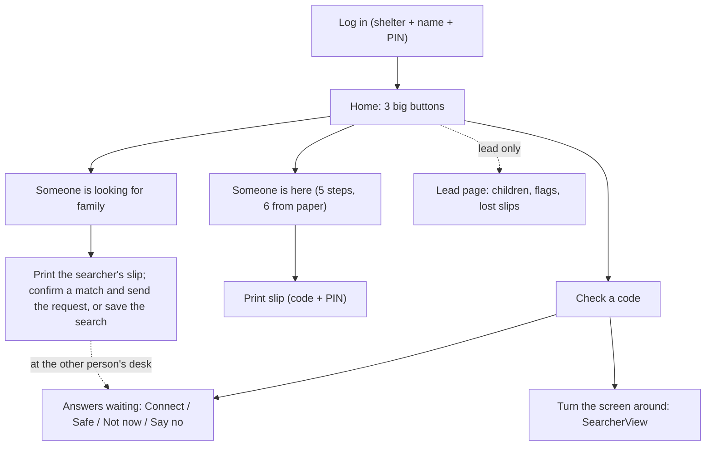

# Frontend choice: React + Vite + TypeScript (a web app run by volunteers)

## TL;DR

A **web app** built with **React + Vite + TypeScript**, hosted on **Netlify**, with:

- **React Hook Form + zod** for forms
- **TanStack Query** for talking to the backend
- **TypeScript types generated from the backend's OpenAPI spec**
- **plain CSS** with large, high-contrast controls

The people using it are **not experts**: tired volunteers at 2 a.m., on whatever laptop or tablet the shelter has, on bad Wi-Fi, with a line of worried families in front of them. So the frontend was designed around one question:

> **Can a volunteer who has never seen this app do the right thing, without training?**

1. **Few features, done well.** Five main screens, one main action on each. Everything else waits.
2. **The screen tells you what to do and what to say.** Plain words, big buttons, one question at a time, and a "Say:" box with the exact words to read out.
3. **Mistakes are hard to make and easy to fix.** Only a name is required, the code box only keeps characters a code can have, drafts survive a dropped connection, and the screen shown to a searcher has no place for a location.

---

## First decision: a web app, not a native app

| Option | Good at | Weak for *this* problem |
| --- | --- | --- |
| **Web app, run by volunteers** ✅ | Works on any laptop or tablet the shelter has; nothing to install; one link; can print slips and forms | Needs a browser and some connection |
| Native phone app | Offline storage, device features | **Survivors don't have phones**; installing from an app store in a disaster is slow; printing is harder |
| Kiosk survivors use themselves | No volunteer needed | Many can't use it (no glasses, stress, language, reading), and nobody is there for consent decisions |

---

## Options I compared

| Option | Good at | Weak for *this* problem |
| --- | --- | --- |
| **React + Vite** ✅ | Familiar to the lab; mature libraries for accessible forms and data fetching; static files that load instantly from Netlify | Ships more JavaScript than the lightest options, so pages are code-split |
| Next.js | Server rendering, full-stack React, very popular | Adds a **second server** next to Spring Boot, which can also sleep on a free tier; server rendering and SEO don't help a staff-only tool |
| SvelteKit | Smaller downloads, less code | Smaller ecosystem for form and accessibility libraries; less familiar to reviewers |

**How they score on what this problem needs:**

| Need (from the scenario) | React + Vite | Next.js | SvelteKit |
| --- | --- | --- | --- |
| Opens instantly even while the backend is asleep | ✅ static files | 🟡 its own server can sleep too | ✅ static files |
| Mature libraries for accessible, step-by-step forms | ✅ | ✅ | 🟡 |
| Small download on slow Wi-Fi | 🟡 code-split per page | 🟡 | ✅ |

React + Vite wins the first two rows, which decide whether a volunteer can use it at all. The download size is handled by loading each page only when it's opened.

---

## Usability rules (HCI)

The users aren't experts, so these rules come first and every screen is checked against them.

| Rule | What it means here | Where you see it |
| --- | --- | --- |
| **Recognition, not recall** | Nobody has to remember a command or a code format; every option is on screen | Home's 3 buttons, the 3 privacy cards, the code keys |
| **Few choices per screen** (Hick's law) | More choices = slower decisions and more mistakes | 3 buttons on Home; one question per step |
| **Big targets** (Fitts's law) | Tired hands and shaky tablets miss small buttons | Every button, key and card at least 48 × 48 px; whole cards are clickable |
| **Prevent errors** | Make the wrong thing impossible instead of explaining it afterwards | Only the name is required; the code box drops look-alike characters; "Back" can't submit a form |
| **Show what's happening, honestly** | A frozen screen makes people press buttons twice or give up | "Step 2 of 5", "Not sent yet", "Connecting, please wait", "This device can't keep a draft" |
| **Speak the user's language** | No technical words like "visibility", "record" or "server" | All text in `strings.ts`; "Say:" boxes with words to read aloud |
| **Forgive and recover** | Interruptions are normal in a shelter line | Drafts kept on reload, quiet retries on bad Wi-Fi, "I don't know" is always a valid answer, an Edit button on every saved person |

---

## Fewer features, on purpose

| Kept | Cut or merged | Why |
| --- | --- | --- |
| **Home**: 3 big buttons | — | Fewer choices, faster decisions |
| **Register** ("Someone is here"): one question per step | **Batch entry** merged into Register: *"Copying from paper forms"* is switched on once, before the first form, and adds one step | One form to learn instead of two |
| **Search** ("Someone is looking for family") | "Who were you with?" household questions | Not in the database yet; adds questions without helping the first match |
| **Check a code**: type it or tap the big keys | — | The main tool for people with no phone |
| **Answers waiting**: what a person decides about a request | Lead tools reduced to one page (matches to confirm for children, flags, lost slips) | Leads are tired too |
| Printable slip + printable blank paper form | Undo history screen, offline mode, Spanish | Moved to **Later**, each with a reason |

---

## The core loop, inside those 5 screens

No extra screens are needed to get two people reconnected; each step happens on a screen that already exists.

1. **Search**: the volunteer types who the person is looking for. Match cards show reasons ("name sounds like…, age close"), never a location.
2. **Search**: the searcher is registered too (a name is enough) and gets a printed slip **every time**, match or not, so they can check back at any desk. If a match looks right, the volunteer confirms it and adds the searcher's message (the box reminds them not to write where the searcher is, because the message is read out before the other person decides), and a contact request is sent; if not, the search is saved.
3. **Answers waiting** at the other person's desk: a volunteer reads the message to them and they choose (see section 2). Someone who chose *"Tell them where I am"* has already said yes, so the volunteer can connect them straight away; children always go to a lead.
4. **Check a code** at **any** desk (or Search at the desk where it was made): the screen is turned around and shows the answer.

---

## Requirements → screens and code

The constraints come first, then the screen and the code that handle each one. Only the six most important snippets are shown; the rest are named under each section. All of them type-check with TypeScript `strict` and were run on sample inputs (2026-10-19).

| # | Constraint (from the scenario) | Handled by |
| --- | --- | --- |
| 1 | Volunteers are non-technical and exhausted | `strings.ts`, `BigButton`, `SayThis`, one question per step |
| 2 | Some people don't want to be found | `VisibilityChoice`, Answers waiting, `SearcherView` |
| 3 | Many people have no phone | `CodeKeypad`, printable slip |
| 4 | Many people have no ID | `registerSchema` (only a name is required) |
| 5 | Each shelter keeps its own list, some on paper | Paper mode, printable blank form, `toRegisterRequest` |
| 6 | Bad Wi-Fi and a free server that sleeps | `queryClient`, `ConnectionBanner`, `useDraft` |
| 7 | Shared laptops, left on desks | `useIdleLock`, `AppShell`, `clearAllDrafts` |

### 1. "Volunteers are non-technical and exhausted"

- **`strings.ts`** holds every word the app shows or reads out to screen readers. I can read the whole app's text in one file and remove jargon, and it's ready for Spanish later.
- **Home has just 3 big buttons**: *Someone is here*, *Someone is looking for family*, *Check a code*. A badge shows answers waiting and children without an adult.
- **`BigButton`** is the one look for every main action: big, full width on a tablet, words instead of icons. It's `type="button"` unless it's the save button, so "Back" can never save a form by accident.
- **`SayThis`** shows the exact words to read out on every screen, so a volunteer never has to make up how to explain privacy to a frightened person.
- **One question per step**, with "Step 2 of 5" at the top, and every saved person has an **Edit** button for fixing a typo afterwards.

Code (type-checked, left out here for length): `strings.ts`, `components/BigButton.tsx`, `components/SayThis.tsx`.

```css
/* styles/tokens.css: the sizes and colors every screen uses */
:root {
  --tap-min: 48px;          /* smallest thing you can press, in both directions */
  --text: 18px;             /* readable without glasses */
  --ink: #1a1a1a;           /* near-black on white: strong contrast */
  --paper: #ffffff;
  --focus: #1c7293;         /* a thick, visible focus ring for keyboard users */
}
body { color: var(--ink); background: var(--paper); font-size: var(--text); line-height: 1.5; }
button, input { min-height: var(--tap-min); min-width: var(--tap-min); font-size: var(--text); }
.big-button { display: flex; flex-direction: column; width: 100%; min-height: calc(var(--tap-min) * 1.5); }
.choice-card { display: flex; flex-direction: column; gap: 4px; min-height: var(--tap-min); padding: 12px 16px; }
.keypad { display: grid; grid-template-columns: repeat(auto-fill, minmax(var(--tap-min), 1fr)); gap: 8px; }
:focus-visible { outline: 3px solid var(--focus); outline-offset: 2px; }
```

### 2. "Some people don't want to be found"

- **`VisibilityChoice`** shows three big cards instead of a dropdown, each explained in plain words, with *Ask me first* already selected. The question is asked in the person's words: *"If someone comes looking for you, what should we do?"*
- The explanations only promise what the system really does: *"Keep me out of searches"* says that shelter staff will still know, and *"Tell them where I am"* means a volunteer can connect them to family without asking again (safety checks and the child rule still apply).
- **Answers waiting** buttons say exactly what they do: *Connect with Maria*, *Tell Maria I'm safe (not where I am)*, *Not now*, *Say no to this request*. Before "Connect" is confirmed, the screen shows exactly what will be shared.
- **`SearcherView`** is the "turn the screen around" view. It replaces the **whole** screen, so no staff menus, badges or other people are visible behind it. "No match", "hidden", "declined" and "pending" all show the same sentence.
- Its `SearcherStatus` type, generated from the backend, has no shelter or address field. Only a *Connected* answer carries a contact plan, and the backend sends one only after the other person said yes. A searcher's status is always asked fresh from the backend: `freshOnly` shows an answer only after a request made for this screen has succeeded and nothing newer is loading, otherwise the screen says *"Checking for the latest answer…"*. So every time the screen is opened, a safety flag added since then wins. The screen is only shown for a moment at the desk; what the searcher already saw can't be taken back.

```tsx
// components/VisibilityChoice.tsx
// Three big cards instead of a dropdown: every choice is visible and explained in plain words.
import { t } from "../strings";

export type Visibility = "findable" | "ask" | "hidden";
const options: Visibility[] = ["findable", "ask", "hidden"];

type Props = { value: Visibility; onChange: (v: Visibility) => void };

export function VisibilityChoice({ value, onChange }: Props) {
  return (
    <fieldset className="choice-cards">
      <legend>{t.steps.privacy}</legend>
      {options.map((v) => (
        // The whole card is the click target, not just the small radio circle.
        <label key={v} className={value === v ? "choice-card is-selected" : "choice-card"}>
          <input
            type="radio"
            name="visibility"
            value={v}
            checked={value === v}
            onChange={() => onChange(v)}
          />
          <strong>{t.visibility[v].label}</strong>
          <span>{t.visibility[v].hint}</span>
        </label>
      ))}
    </fieldset>
  );
}
```

```tsx
// components/SearcherView.tsx
// The "turn the screen around" view, safe to show the person who is searching.
// It replaces the WHOLE screen (no staff menus, badges or other people behind it).
// SearcherStatus has no shelter or address field; only a "Connected" answer carries
// a contact plan, and the backend sends one only after the other person said yes.
import type { SearcherStatus } from "../api/schema";
import { t } from "../strings";

function message(status: SearcherStatus) {
  switch (status.type) {
    case "Active":     // no match, hidden, pending, declined, blocked: all look the same
      return <p>{t.searcher.active}</p>;
    case "Safe":
      return <p>{t.searcher.safe}</p>;
    case "Connected":  // the only case with details, and only because they said yes
      return (
        <>
          <p>{t.searcher.connected}</p>
          <p className="contact-plan">{status.contactPlan}</p>
        </>
      );
    default: {
      // A new status from the backend stops the build until someone decides what the searcher sees.
      const unhandled: never = status;
      void unhandled;
      return <p>{t.searcher.active}</p>;   // and if it ever slips through at runtime: the safe answer
    }
  }
}

// `status` comes through freshOnly(): undefined means a fresh answer isn't here yet.
export function SearcherView({ status, onDone }: { status: SearcherStatus | undefined; onDone: () => void }) {
  return (
    <main className="searcher-view">
      {status ? message(status) : <p role="status">{t.searcher.checking}</p>}
      <button type="button" className="big-button" onClick={onDone}>
        {t.searcher.giveBack}
      </button>
    </main>
  );
}
```

### 3. "Many people have no phone"

- **Everyone registered gets a printed slip**, searchers included, with a code, a PIN and the shelter desk phone, so they can check for messages at any desk without a phone.
- **`CodeKeypad`** has a normal text box (type or paste "hw-7k3p") **and** big keys for a tablet. Either way, only characters a code can contain are kept, so "0 or O?" never comes up. "HW" is only removed when it's clearly the prefix, because H and W can also be part of a code.
- The volunteer then types the PIN; a wrong code and a wrong PIN get the same answer, and after 5 wrong PINs the code is locked for 15 minutes (backend).
- **A lost slip** is reissued by a lead from the Lead page; if the printer is broken, the volunteer writes the code and PIN on paper by hand.
- The phone field is optional and says so, and contact plans use desk phones: *"Call the Westfield desk and ask for Rosa."*

```tsx
// components/CodeKeypad.tsx
// For people with no phone: the volunteer enters the code from the printed slip.
// Type it, paste it, or tap the big keys. Only characters a code can contain are kept.
import { t } from "../strings";

const ALPHABET = "23456789ABCDEFGHJKLMNPQRSTUVWXYZ";   // same as the backend: no 0/O, no 1/I
const CODE_LENGTH = 4;

// For typed or pasted text: "hw-7k3p", "HW 7K3P", "HW7K3P" and "7K3P" all become "7K3P".
// "HW" is only treated as the prefix when it's clearly the prefix, because H and W can be part of a code.
export function normalizeCode(raw: string): string {
  let text = raw.toUpperCase().trim();
  if (/^HW[\s-]/.test(text)) text = text.slice(3);                   // "HW-7K3P", "HW 7K3P"
  let chars = [...text].filter((ch) => ALPHABET.includes(ch));
  if (chars.length > CODE_LENGTH && chars[0] === "H" && chars[1] === "W") chars = chars.slice(2);  // "HW7K3P"
  return chars.slice(0, CODE_LENGTH).join("");
}

type Props = { value: string; onChange: (v: string) => void };

export function CodeKeypad({ value, onChange }: Props) {
  // A key adds exactly one character; no prefix guessing, so tapping H then W keeps "HW".
  const press = (ch: string) => {
    if (value.length < CODE_LENGTH) onChange(value + ch);
  };

  return (
    <div className="code-keypad">
      <label className="code-input">
        {t.code.label}
        <span className="code-input__row">
          HW-
          <input
            value={value}
            onChange={(e) => onChange(normalizeCode(e.target.value))}
            autoComplete="off"
            autoCapitalize="characters"
            spellCheck={false}
            inputMode="text"
            maxLength={12}   // room for a pasted "HW-7K3P"; normalizeCode keeps 4
          />
        </span>
      </label>
      <div className="keypad" role="group" aria-label={t.code.keys}>
        {[...ALPHABET].map((ch) => (
          <button type="button" key={ch} onClick={() => press(ch)}>
            {ch}
          </button>
        ))}
        <button type="button" onClick={() => onChange(value.slice(0, -1))} aria-label={t.code.delete}>
          ⌫
        </button>
      </div>
    </div>
  );
}
```

### 4. "Many people have no ID"

- **`registerSchema`** checks the Register form. The only required answer is a name or nickname, and the screen says *"It doesn't have to be your legal name."*
- The age box accepts "80" or nothing; empty means "unknown", not 0, the same as in the database. Typing "unknown" gets a plain sentence, not an error code.
- There are **no ID, date-of-birth or immigration questions anywhere**, so a volunteer can't ask for them by habit. The optional step asks *"Anything that helps recognise them?"* ("red jacket, walks with a cane"), which helps when names don't match.
- If the person may be a child, one more question appears: *"Is an adult from their family with them?"* A "no" puts them at the top of the lead's list.
- The form checks the same rules as the database first (paper needs a sheet and line, age and "under 18" must agree, slip codes look like `HW-7K3P`), so the volunteer gets a friendly sentence instead of a database error.

```ts
// forms/registerSchema.ts
// What the Register form accepts. Only the name is required; "I don't know" is always a valid answer.
import { z } from "zod";
import { t } from "../strings";

// The age box: empty means "unknown" (never 0); "80" typed as text is fine; anything else gets a plain message.
const optionalAge = z
  .union([z.string(), z.number(), z.null(), z.undefined()])
  .transform((v, ctx) => {
    if (v === undefined || v === null || (typeof v === "string" && v.trim() === "")) return undefined;
    const n = typeof v === "number" ? v : Number(v.trim());
    if (!Number.isInteger(n)) {
      ctx.addIssue({ code: z.ZodIssueCode.custom, message: t.age.notNumber });
      return z.NEVER;
    }
    if (n < 0 || n > 120) {
      ctx.addIssue({ code: z.ZodIssueCode.custom, message: t.age.outOfRange });
      return z.NEVER;
    }
    return n;
  });

const slipCode = z
  .string()
  .trim()
  .toUpperCase()
  .regex(/^HW-[2-9A-HJ-NP-Z]{4}$/, t.paper.badSlip)   // same format as the database
  .optional()
  .or(z.literal("").transform(() => undefined));

// A real calendar date in yyyy-mm-dd. (JavaScript would quietly turn "2026-02-30" into March 2,
// so the date is built and read back to make sure nothing rolled over.)
function isCalendarDate(d: string): boolean {
  const m = /^(\d{4})-(\d{2})-(\d{2})$/.exec(d);
  if (!m) return false;
  const [y, mo, day] = [Number(m[1]), Number(m[2]), Number(m[3])];
  const date = new Date(Date.UTC(y, mo - 1, day));
  return date.getUTCFullYear() === y && date.getUTCMonth() === mo - 1 && date.getUTCDate() === day;
}

// The date written on a paper form: empty is fine, a real calendar date is fine, anything else gets a message.
const paperDate = z
  .string()
  .trim()
  .refine((d) => d === "" || isCalendarDate(d), t.paper.badDate)
  .transform((d) => (d === "" ? undefined : d))
  .optional();

export const registerFields = z.object({
  preferredName: z.string().trim().min(1, t.name.missing).max(100, t.name.tooLong),
  otherNames: z.array(z.string().trim().min(1)).default([]),
  approxAge: optionalAge,
  isMinor: z.boolean().optional(),                           // undefined = not sure
  unaccompanied: z.boolean().default(false),                 // asked only when they may be a child
  homeArea: z.string().trim().optional(),
  description: z.string().trim().max(500).optional(),     // anything that helps recognise them
  phone: z.string().trim().optional(),
  visibility: z.enum(["findable", "ask", "hidden"]).default("ask"),   // safe default
  // Paper mode is chosen once, before the first form, and stays on for the whole stack.
  fromPaper: z.boolean().default(false),
  paperRef: z.string().trim().optional(),
  paperDate,                                                 // the date written on the paper (yyyy-mm-dd)
  slipCode,
});

// Same rules as the database, checked here first so the volunteer gets a friendly sentence.
export const registerSchema = registerFields
  .refine((f) => !f.fromPaper || !!f.paperRef, { path: ["paperRef"], message: t.paper.sheetLine })
  // The database would store "now" if the date were missing, which isn't when it was written down.
  .refine((f) => !f.fromPaper || !!f.paperDate, { path: ["paperDate"], message: t.paper.dateMissing })
  .refine((f) => !(f.isMinor === false && f.approxAge !== undefined && f.approxAge < 18), {
    path: ["isMinor"],
    message: t.age.childMarkedAdult,
  })
  .refine((f) => !(f.isMinor === true && f.approxAge !== undefined && f.approxAge >= 18), {
    path: ["isMinor"],
    message: t.age.adultMarkedChild,
  });

export type RegisterForm = z.infer<typeof registerSchema>;

// For drafts: whatever was typed so far, unfinished or not. Only the shape is checked here;
// the full rules run when the volunteer presses Save.
// recordId is the id made when the form opened (newRecordId): keeping it in the draft means a
// reload re-sends the SAME id, so the database ignores the repeat instead of making a second person.
export const registerDraftSchema = z
  .object({
    recordId: z.string().uuid(),
    preferredName: z.string(),
    otherNames: z.array(z.string()),
    approxAge: z.union([z.string(), z.number(), z.null()]),
    isMinor: z.boolean(),
    unaccompanied: z.boolean(),
    homeArea: z.string(),
    description: z.string(),
    phone: z.string(),
    visibility: z.enum(["findable", "ask", "hidden"]),
    fromPaper: z.boolean(),
    paperRef: z.string(),
    paperDate: z.string(),
    slipCode: z.string(),
  })
  .partial();

// One question per screen; the volunteer always sees "Step 2 of 5".
type Step = { id: string; title: string; fields: ReadonlyArray<keyof RegisterForm>; optional?: boolean };

export function registerSteps(fromPaper: boolean): Step[] {
  return [
    ...(fromPaper ? [{ id: "paper", title: t.steps.paper, fields: ["paperRef", "paperDate", "slipCode"] } as Step] : []),
    { id: "name", title: t.steps.name, fields: ["preferredName", "otherNames"] },
    { id: "age", title: t.steps.age, fields: ["approxAge", "isMinor", "unaccompanied"] },
    { id: "privacy", title: t.steps.privacy, fields: ["visibility"] },
    { id: "extra", title: t.steps.extra, fields: ["homeArea", "description", "phone"], optional: true },
    { id: "check", title: t.steps.check, fields: [] },
  ];
}
```

### 5. "Each shelter keeps its own list, some on paper"

- **There's no separate batch-entry screen.** Before the first form, the volunteer switches on *"Copying from paper forms"*. It stays on for the whole stack and adds one first step: where it is on the paper, the date written on it (required; if there's none, the day the forms were collected), and the slip code if a pre-printed slip was handed out.
- The paper date stays filled in between forms, and Enter moves to the next text box, so copying a stack of forms is fast.
- **A printable blank form** has the same questions in the same order as the app, so copying from paper is a straight line down the page.
- **A pre-printed slip** is handed out with the paper form and starts working once its code is typed in with that form; the slip says so in plain words.
- **`toRegisterRequest`** is the one place the form becomes the backend's request. The record's ID is made once in the browser when the form opens and kept in the draft, so a re-send after a Wi-Fi drop is ignored by the database instead of creating a second person.

Code (type-checked, left out here for length): `forms/toRequest.ts`.

### 6. "Bad Wi-Fi and a free server that sleeps"

- **`queryClient`** retries quietly (1 s, 2 s, 4 s…) when the network or server hiccups, and never retries "not allowed" or "please check" answers.
- Saves are **not** retried automatically, except registration, which is safe to repeat because it re-sends the same ID. A decision or a PIN check is never repeated by accident.
- **`ConnectionBanner`** says honestly what's going on: *"No internet right now…"*, *"1 not sent yet…"*, *"Connecting. Please wait…"*, or *"This device can't keep a draft…"* if the browser won't store one.
- **`useDraft`** keeps a half-typed form if the page reloads or the connection drops, so an interruption doesn't lose work. A draft is kept as typed, unfinished answers included; the full rules only run on Save.
- The page itself loads instantly from Netlify even while the free backend is starting, so the volunteer sees the banner instead of a blank page.

```ts
// api/queryClient.ts
// Bad Wi-Fi is normal in a shelter: retry quietly, but only when retrying can help.
import { QueryClient, queryOptions } from "@tanstack/react-query";
import type { SearcherStatus } from "./schema";
import { HttpError } from "./http";

// Retry network trouble and server hiccups (5xx), never "not allowed" or "check your input" (4xx).
const worthRetrying = (count: number, error: Error) =>
  count < 3 && !(error instanceof HttpError && error.status < 500);

export const queryClient = new QueryClient({
  defaultOptions: {
    queries: {
      retry: worthRetrying,
      retryDelay: (attempt) => Math.min(1000 * 2 ** attempt, 15_000),  // 1 s, 2 s, 4 s … max 15 s
    },
    mutations: {
      retry: false,   // off by default: a decision or a PIN check must not be repeated by accident.
                      // Registration turns it on, because it re-sends the same id (see toRequest.ts).
    },
  },
});

// What a searcher sees is asked fresh every time and never kept in memory,
// so a safety flag added a minute ago always wins over an old "Connected".
export const searcherStatusQuery = (searchId: string, fetchStatus: (id: string) => Promise<SearcherStatus>) =>
  queryOptions({
    queryKey: ["searcher-status", searchId],
    queryFn: () => fetchStatus(searchId),
    staleTime: 0,
    gcTime: 0,
    refetchOnMount: "always",
  });

// Show a searcher an answer only if it came from a request made for THIS screen, the latest
// request succeeded, and nothing newer is loading or waiting for the internet ("paused").
// Otherwise the screen says "Checking…".
export function freshOnly<T>(q: {
  data: T | undefined;
  status: "pending" | "error" | "success";
  fetchStatus: "fetching" | "paused" | "idle";
  isFetchedAfterMount: boolean;
}): T | undefined {
  return q.status === "success" && q.fetchStatus === "idle" && q.isFetchedAfterMount ? q.data : undefined;
}
```

Also type-checked, left out here for length: `api/http.ts`, `components/ConnectionBanner.tsx`, `hooks/useDraft.ts`.

### 7. "Shared laptops, left on desks"

- **`useIdleLock`** locks the app after 10 minutes with no clicks or typing. It checks the clock, not just a timer, so a laptop that went to sleep locks as soon as it wakes.
- Only a person counts as activity: background refreshes don't keep it unlocked. The backend has the same 10-minute rule and is the real lock; unlocking always goes through the backend's PIN check.
- **`AppShell`** shows the lock screen **instead of** the app, so every page, form and person on screen is removed, not just hidden. Loaded data is cleared and anything still loading is stopped.
- Drafts are tied to the logged-in volunteer, expire after a shift, and are removed by **`clearAllDrafts`** on logout and when a different volunteer logs in.
- Drafts live in `sessionStorage` (one browser tab), never in `localStorage`. This isn't a secure wipe of the device, so the README asks shelters to log out at the end of every shift.

```ts
// hooks/useIdleLock.ts
// Laptops get left on desks. After 10 minutes with no clicks or typing, the app locks.
// Only a person counts as activity; background refreshes don't. The backend has the same
// 10-minute rule and is the real lock: unlocking always goes through it (verifyPin).
import { useEffect, useRef, useState } from "react";
import { useQueryClient } from "@tanstack/react-query";

const IDLE_MS = 10 * 60 * 1000;

export function useIdleLock(verifyPin: (pin: string) => Promise<boolean>) {
  const [locked, setLocked] = useState(false);
  const queryClient = useQueryClient();
  const lastActivity = useRef(Date.now());

  useEffect(() => {
    const expired = () => Date.now() - lastActivity.current >= IDLE_MS;
    const lock = () => {
      void queryClient.cancelQueries();   // stop anything still loading
      queryClient.clear();                // forget every person loaded so far
      setLocked(true);
    };
    // Activity after the deadline doesn't buy more time: it locks.
    const onActivity = () => (expired() ? lock() : (lastActivity.current = Date.now()));
    // Timers pause when a laptop sleeps, so also check the clock on wake-up and every 15 s.
    const onVisible = () => document.visibilityState === "visible" && expired() && lock();
    const tick = window.setInterval(() => expired() && lock(), 15_000);

    const events = ["pointerdown", "keydown"] as const;
    events.forEach((e) => window.addEventListener(e, onActivity));
    document.addEventListener("visibilitychange", onVisible);
    return () => {
      window.clearInterval(tick);
      events.forEach((e) => window.removeEventListener(e, onActivity));
      document.removeEventListener("visibilitychange", onVisible);
    };
  }, [queryClient]);

  // Unlocks only if the backend accepts the PIN, and starts a fresh 10 minutes.
  const unlock = async (pin: string) => {
    if (!(await verifyPin(pin))) return false;
    lastActivity.current = Date.now();
    setLocked(false);
    return true;
  };

  return { locked, unlock };
}
```

Also type-checked, left out here for length: `components/AppShell.tsx`.

---

## Screen map



*Five main screens, one main action each. The lead page is only shown to leads.*

---

## How I'll test it with non-experts

Usability can't be checked by a type checker, so I'll test it with people.

- **Who:** 3–5 people who aren't developers (friends or family), on a tablet, with no explanation of the app.
- **Tasks:**
  1. Register "Rosa, about 80, doesn't want her ex-husband to find her" (target: **under 2 minutes**).
  2. A man is looking for his daughter Mia, 9. Start a search and show him the screen.
  3. Check the code on this printed slip.
  4. Halfway through task 1, reload the page (a Wi-Fi drop): can they carry on?
  5. Leave the tablet for 10 minutes, then come back: do they understand the lock screen?
  6. Copy two paper forms in a row, using only the keyboard.
- **What I write down:** time per task, every place they hesitate or ask "what does this mean?", every wrong tap, and whether they can say what the other person will be told.
- **What I change:** any word that confuses two people gets rewritten in `strings.ts`; any button missed twice gets bigger or moves. Anyone misunderstanding what will be shared is a blocker that's fixed before anything else.
- I'll repeat the test after the changes and put the before/after times in the README.

---

## Frontend layout

```
client/src/
  api/schema.ts            generated from the backend's OpenAPI (never edit by hand)
  api/http.ts              HttpError (status code, for retry decisions)
  api/queryClient.ts       retries for bad Wi-Fi; searcher status always fresh
  strings.ts               every word the app shows or reads out
  pages/                   Login, Home, Register, Search, CheckCode, Answers, Lead, Print
  components/              AppShell, BigButton, SayThis, VisibilityChoice, SearcherView, CodeKeypad, ConnectionBanner
  forms/                   registerSchema.ts (what the form accepts), toRequest.ts (form → backend request)
  hooks/                   useDraft, useIdleLock
  styles/                  tokens.css (sizes, contrast), print.css (slip and blank form)
```

---

## Later (not in the MVP)

| Feature | Why it waits |
| --- | --- |
| **Offline mode** (save forms with no internet and send later) | Drafts and safe retries cover short drops; a full offline queue is a lot of extra code to get right |
| **Undo history screen** | Everyday mistakes are fixed with the Edit button; the database keeps a snapshot of every edit for a lead to look at if something goes badly wrong |
| **Spanish and other languages** | All text is already in `strings.ts`, so adding a language is a translation job, not a code change. Until then, when a person doesn't speak English, the volunteer asks the lead for an interpreter before any consent question |
| **Household links** ("Who were you with?") | Needs a database change; one person at a time works first |
| **Self-service "I'm safe" page** for survivors | Needs the same privacy rules made public-safe; volunteers come first |

---

## Tradeoffs I'm accepting

| Gave up | How I reduce the cost |
| --- | --- |
| **Fewer features** than a full disaster system | The features that are there are easy to use without training; the rest is listed under **Later** |
| **Online-first** (no full offline mode) | Drafts kept on the device, quiet retries, safe re-sends with browser-made IDs, and an honest banner |
| **A bigger download** than SvelteKit | Each page loads only when it's opened; no heavy UI library |
| **Survivors can't use it themselves** | A volunteer at every step means it works without a phone, glasses or reading, and a person handles consent; an interpreter is fetched for anyone who doesn't speak English |
| **A separate frontend host** (Netlify) | The page loads instantly even while the backend sleeps; Netlify forwards `/api/*`, so cookies work without extra setup |
