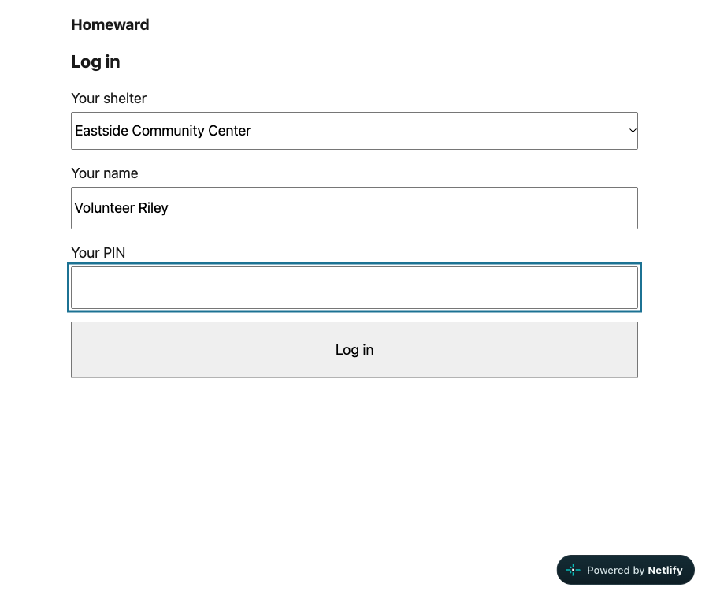
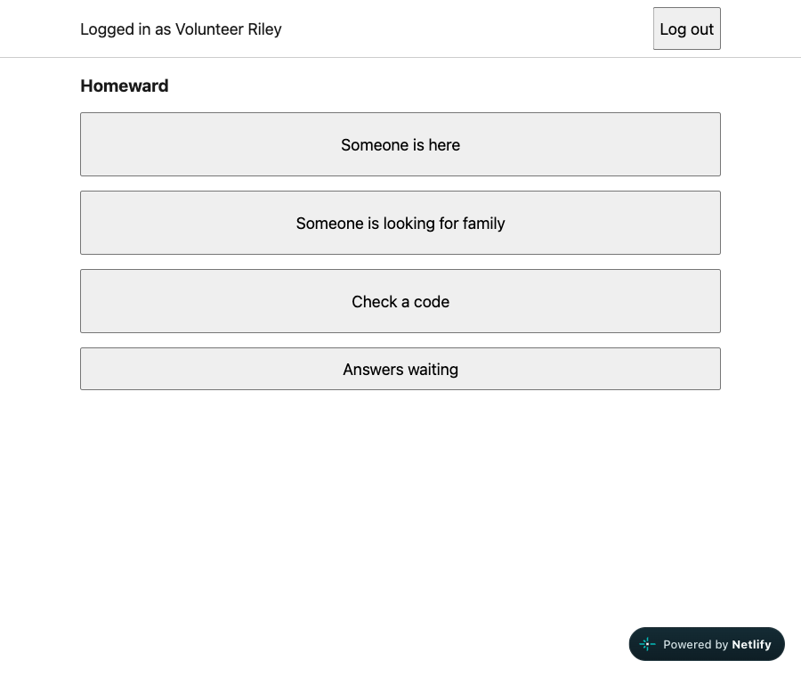
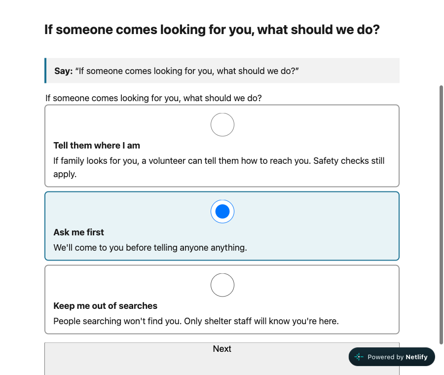
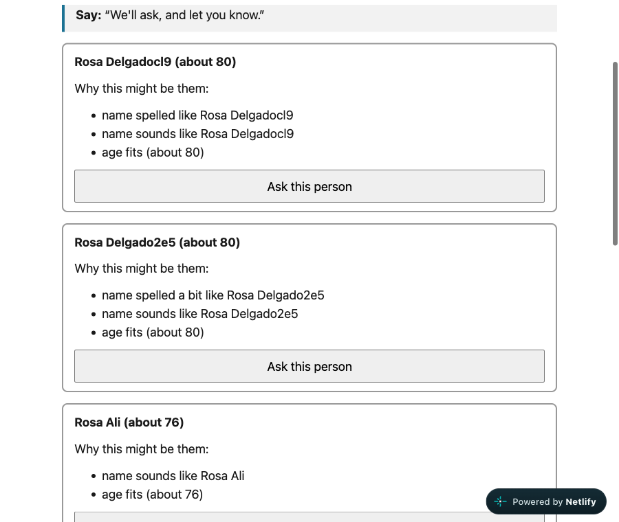
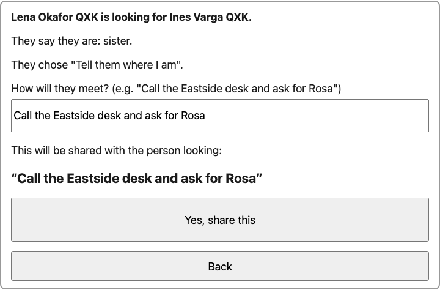
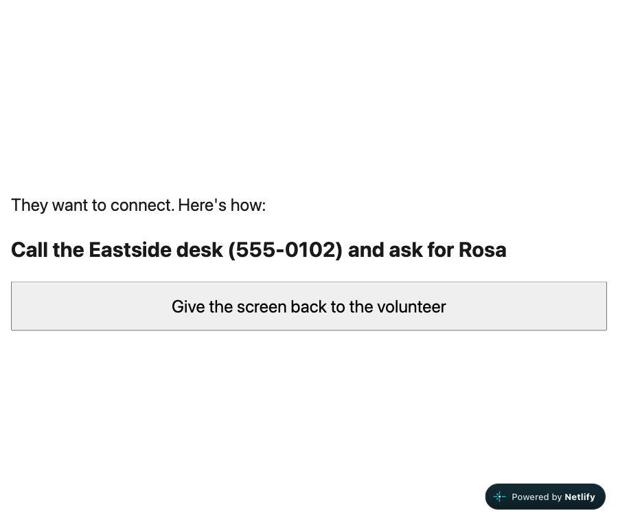
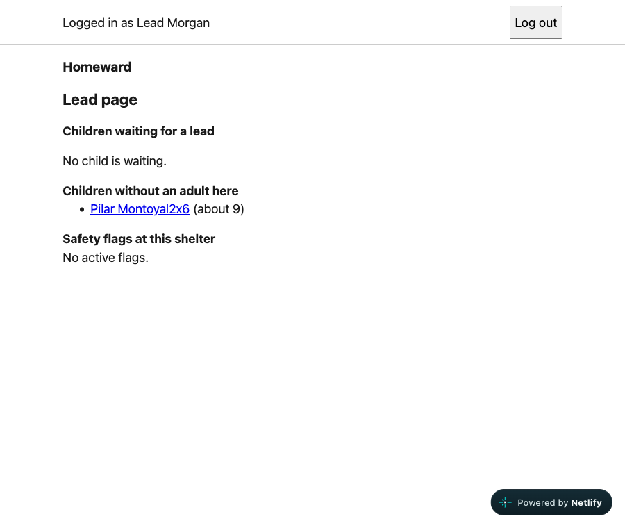

# Homeward: a shelter-run reunification desk

> Fullstack Challenge 26F · Reuniting Separated Families

**Live:** https://hilarious-cassata-a51a3c.netlify.app
(backend: https://homeward-api-fjrc.onrender.com/api/health). The backend runs on Render's free plan and sleeps after about 15 minutes without visitors, so the first visit can take 30 to 60 seconds. The page says "Connecting. Please wait" meanwhile.

**Demo logins** (fictional shelters and staff; demo PIN **2468** for all of them):

| Shelter | Volunteer | Lead (also sees the lead page) |
|---|---|---|
| Lincoln High Shelter | Volunteer Alex | Lead Jordan |
| Eastside Community Center | Volunteer Riley | Lead Morgan |
| Westfield High Gym | Volunteer Casey | Lead Taylor |

All people in the demo are made up: three shelters, six staff and 200 generated names. Nothing real is stored.

---

## Overview

After a hurricane evacuation of about 400,000 people, families are split across dozens of shelters. Many people have **no phone and no ID**, some **don't want to be found**, shelters keep their **own lists (some on paper)**, and the people at the desks are **tired, non-technical volunteers**.

Homeward is the desk tool those volunteers use **on behalf of** survivors:

1. **Someone is here:** register a person in under two minutes. Only a name or nickname is required, and a paper mode copies paper forms in stacks. They choose what happens if someone looks for them (*Ask me first* is the default), and they get a printed **slip with a code and a PIN**.
2. **Someone is looking for family:** the person looking is registered too, and the search finds **possible matches across every shelter**. Spelling, sound-alike names, nicknames and age become a score with **plain-English reasons**. **No place is ever shown.**
3. **Answers waiting:** at the found person's own desk, a volunteer reads the message out, and **they decide**: *Connect*, *Tell them I'm safe (not where I am)*, *Not now* or *Say no*.
4. **Check a code:** at **any** desk, the slip's code and PIN show the person looking their answer on a full-screen view. Every "no" looks exactly like "still looking".

| Login | Home: three big buttons |
|---|---|
|  |  |

| Register: the privacy question, in the person's words | Search: possible matches, with reasons and no place |
|---|---|
|  |  |

| Answers waiting: "Connect" shows exactly what will be shared | The searcher's screen (turned around) |
|---|---|
|  |  |

The lead page holds children waiting for a sign-off, children without an adult, and safety flags:



### Try it (about 3 minutes)
1. Log in as **Volunteer Riley** at **Eastside**. Choose *Someone is here*, then *No, the person is here with me*, and register "Rosa", about 80, *Ask me first*. Save.
2. Log out. Log in as **Volunteer Alex** at **Lincoln**. Choose *Someone is looking for family*, enter her son "Marco" (an adult), and search for "Rossa", 75 to 85. Her card shows reasons and no place. Choose *Ask this person*, add a message, then *Done: print their slip* and print it, noting the code and PIN.
3. Log out. At **Westfield** (Volunteer Casey), choose *Check a code*, type Marco's code and PIN, then *Turn the screen around*. It says: *"Your request is saved…"*.
4. Log out. At **Eastside** (Riley), open *Answers waiting*, choose *Connect with Marco*, write how they'll meet, and confirm.
5. Back at **Westfield**, check Marco's slip again: *"They want to connect. Here's how: …"*.

Try a child too. Register a 9-year-old at Eastside and search for her from Lincoln. The volunteer gets no buttons, only *"a lead decides"*. Lead Morgan at Eastside releases her from the lead page, after a guardian check, a note and a preview of what will be shared.

---

## The full picture

The challenge covers the whole reunification problem. I built **one complete loop: Register → Match → Consent → Reconnect**, because every other part depends on it working safely. A sketch of the rest is in [`PROPOSAL.md` §4](PROPOSAL.md#4-the-full-picture-how-the-rest-would-work).

| Part | In this build | How the rest would work |
|---|---|---|
| Intake at shelters | Volunteer desk, paper mode, printed slips | Agency list imports (nursing homes, hospitals) as `source = import` |
| Finding people | Cross-shelter fuzzy matching with reasons; "Check again" finds people registered later | Nightly re-runs; household groups ("who were you with?") |
| Consent | Ask-first default, findable / hidden, Connect / Safe / Not now / No, children through a lead, safety flags | Adults who can't decide for themselves, through a lead |
| No phone | Slip with code + PIN, readable at any desk | SMS / hotline for people who do have a phone |
| Coordination | Lead page per shelter | A coordinator view across shelters; data retention job (90 days) |

---

## Design

**Users:** the main user is a **tired volunteer at 2 a.m.**, on a laptop or tablet, often on bad Wi-Fi. The survivor never logs in. They talk to the volunteer, and for a moment they see a screen turned towards them. Leads handle children, flags and lost slips.

**Usability choices** (details in [`FRONTEND.md`](FRONTEND.md)):
- **Three big buttons** on Home, **one question per screen**, "Step 2 of 5", and plain words in one file (`strings.ts`).
- **"Say:" boxes** give the exact words to read out, so nobody has to improvise how to explain privacy.
- **Only the name is required.** "I don't know" is always valid, and an unknown age is never `0`.
- **Drafts survive a reload or a dropped connection.** A retried save never creates a second person: the browser makes the id once.
- **The screen locks after 10 minutes** on a shared laptop, and the lock screen replaces the whole app.

**Edge cases handled** (each one tested):

| Situation | What happens |
|---|---|
| Someone doesn't want to be found | *Keep me out of searches* means never suggested, even by exact name. A `do_not_disclose` flag beats "findable". |
| Searcher may be the person they fled | No match, hidden, pending, declined and blocked all give the **byte-identical** reply `{"type":"Active"}`, at every desk |
| A flag added **after** "Connect" | The reveal is withdrawn at once (database trigger); the searcher sees "still looking" again |
| A child, found or searching | Never released by a name match: only a lead at the found person's desk, with a guardian check, a note and a preview. An unknown age counts as a child. |
| No phone | The slip's code + PIN work at any desk; 5 wrong PINs lock it for 15 min, even if sent in parallel |
| Paper forms, typed in later | Paper mode keeps where it came from ("Sheet 4, line 12") and the date written on the paper; "Check again" finds them for older searches |
| Bad Wi-Fi, double clicks | Same id on every retry, so stored once; saves waiting for the internet survive the lock |
| Shared laptop | 10-minute lock, the next person's slip check forgets the previous one, logout clears drafts |

---

## Technical choices

| Layer | Choice | Why (full comparisons in the linked docs) |
|---|---|---|
| Database | **PostgreSQL 18 on Neon**, Flyway migrations V1–V5 | `pg_trgm` + `fuzzystrmatch` + `unaccent` for matching in SQL. **Triggers enforce the hardest rules** (children, flags, a request can't move, append-only audit), so a backend bug still can't release a child. The app connects as a least-privilege user. [`DATABASE.md`](DATABASE.md) |
| Backend | **Kotlin + Spring Boot 4**, Spring JDBC (no JPA), Spring Security | Dedicated match types omit location; `SearcherStatus.Connected` carries only the consented contact plan. Visible, parameterized SQL. PIN login, CSRF, idle lock. [`BACKEND.md`](BACKEND.md) |
| Frontend | **React 19 + Vite + TypeScript** (strict), TanStack Query, react-hook-form + zod | Types generated from the backend's OpenAPI; retries only where safe; drafts in `sessionStorage`. [`FRONTEND.md`](FRONTEND.md) |
| Deploy | Netlify (frontend, proxies `/api/*`) → Render (Docker, free) → Neon | One origin for the browser, so the session and CSRF cookies are first-party |

**Biggest tradeoff:** I chose **safety over reach and speed**. A volunteer-run desk, with no self-service app and no public search, reaches fewer people directly than a website anyone can search. But a public search would let an abuser look for the person who fled. Smaller ones:
- **Cold start:** the free JVM sleeps; the frontend shows "Connecting" and logins are retried while it wakes.
- **Scale:** matching reads through a privacy view that probably can't use the name indexes. That's fine at demo scale (about 35 ms on Neon) but needs re-measuring near 400,000 people.
- **Timing:** a wrong slip code and a wrong PIN take *almost* the same time.

### Run it locally
Requires JDK 21 (`JAVA_HOME` pointing to it), Node.js 22.12+ and Docker. Run these checks from the repository root; on this Mac Docker runs through Colima.

```bash
colima start                                   # Docker, for the database tests and Testcontainers
scripts/db-test.sh                             # migrations + seed + 155 SQL checks on PostgreSQL 18.6
(cd server && ./gradlew build)                   # 52 backend tests (Testcontainers, app as homeward_app)
(cd client && npm ci && npm run lint && npm test && npm run build)    # 26 frontend tests
```

For the app, create an ignored `.env.local` with `HOMEWARD_APP_DATABASE_URL` set to the least-privilege `homeward_app` connection URL for a database provisioned with V1–V5 and the fictional seed (see [`DATABASE_PLAN.md`](DATABASE_PLAN.md)). Do not source the file; the runner parses it. In two terminals, each starting at the repository root:

```bash
scripts/run-backend.sh                         # terminal 1: API on :8080
(cd client && npm run dev)                     # terminal 2: http://localhost:5173
```

### How it was built
Built one step at a time across the three layers, each planned first and logged as it went: [`DATABASE_PLAN.md`](DATABASE_PLAN.md) / [`_IMPLEMENTATION.md`](DATABASE_IMPLEMENTATION.md), [`BACKEND_PLAN.md`](BACKEND_PLAN.md) / [`_IMPLEMENTATION.md`](BACKEND_IMPLEMENTATION.md), [`FRONTEND_PLAN.md`](FRONTEND_PLAN.md) / [`_IMPLEMENTATION.md`](FRONTEND_IMPLEMENTATION.md). It followed git-flow (feature → PR into `develop` → release / hotfix into `main`), and every PR was reviewed before merging; the review tables are in the logs. How AI tools were used, including what they got wrong: [`AI_NOTES.md`](AI_NOTES.md). Design deck: `Homeward_Design.pptx`.

### What remains after the demo
The core reunion is implemented and tested. A real-person usability study is still planned; the printable blank paper form, full offline mode, automatic search reruns and retention job are not built. Test results establish behavior in the covered cases, not readiness for a real disaster deployment.
