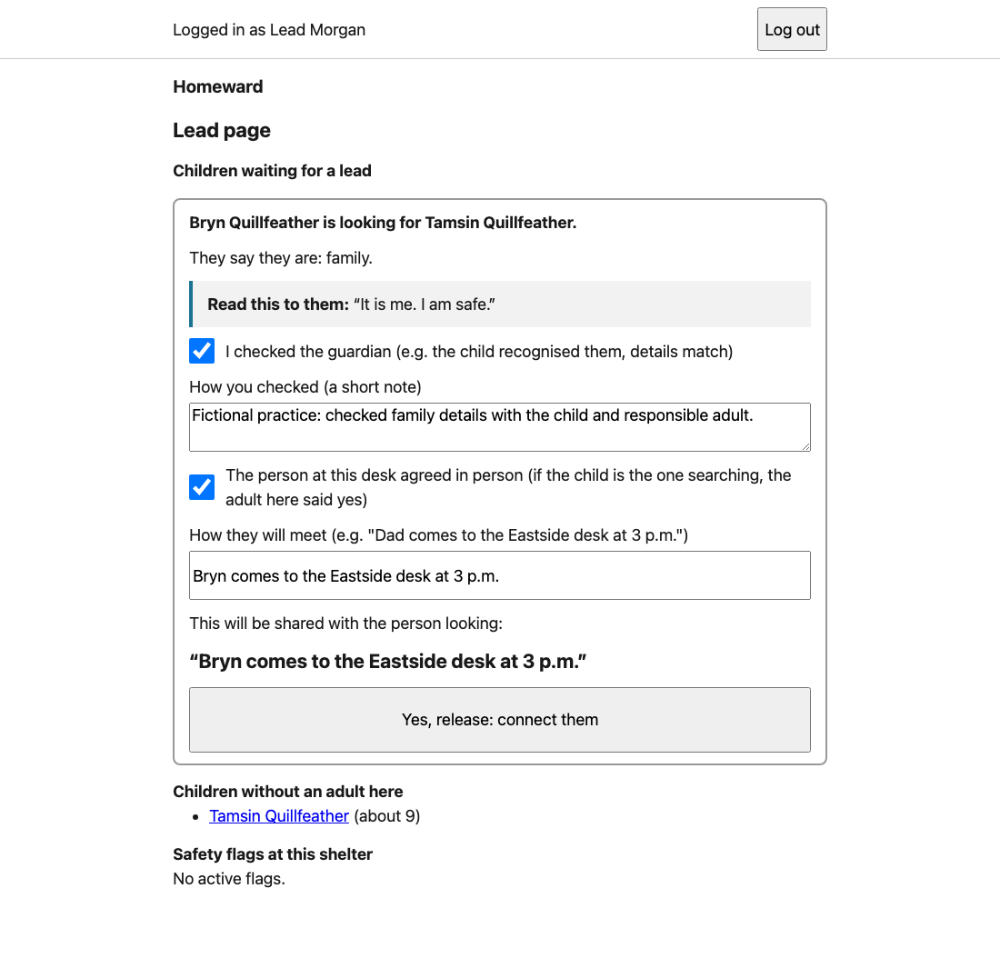
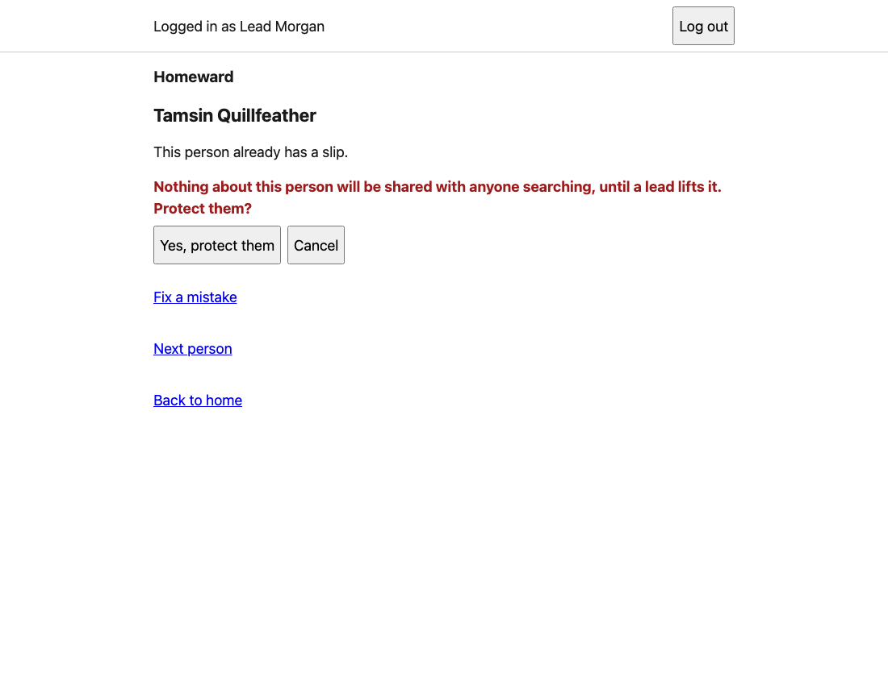
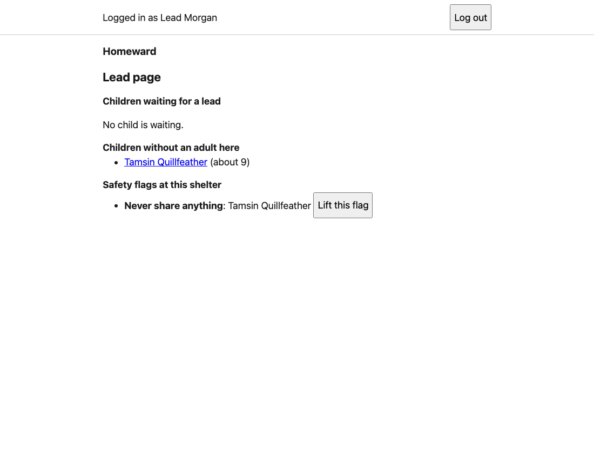
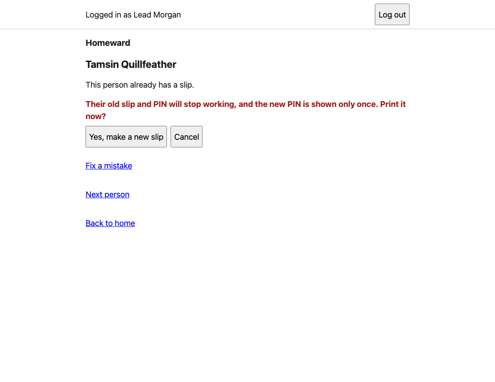

# I'm a lead. What do I do?

[All guides](USER_GUIDE.md) · [Volunteer guide](VOLUNTEER.md) · [Guide for the person asking for help](PERSON_LOOKING_FOR_HELP.md)

You can do the volunteer jobs too. Your extra jobs are checking requests involving children, protecting people, and replacing lost slips.

For practice, open [Homeward](https://hilarious-cassata-a51a3c.netlify.app). Log in at **Eastside Community Center** as **Lead Morgan**, demo PIN **2468**. Use fictional people only. Screenshots are from a separate test copy of version 1.0.4.

To return home, use **Back to home** when it appears, or reopen the [home link](https://hilarious-cassata-a51a3c.netlify.app) in the same tab after finishing the current task.

## First: can I add staff?

**Not in this version.** There is no button to add a volunteer or another lead. Those accounts are set up outside the app. A lead login does not make you an account administrator. See [staff setup](USER_GUIDE.md#can-we-add-a-volunteer-or-lead).

## 1. A child needs help reconnecting

Practice setup:

1. As **Volunteer Riley** at **Eastside**, register **Tamsin Quillfeather**, age **9**, **Under 18**, adult with them **No**, **Ask me first**. Follow the [registration steps](VOLUNTEER.md#2-someone-arrives-register-odalys), then print the slip. Keep its code and PIN for the replacement-slip practice below.
2. Log out. As **Volunteer Alex** at **Lincoln**, search for Tamsin. The person looking is **Bryn Quillfeather**, **Yes** for 18 or over. Search **Tamsin Quillfeather**, ages **8** to **10**, relationship **family**. Press **Ask this person**, send the request, then print Bryn's slip.
3. As Riley at Eastside, open **Answers waiting**. The card should say **A child is involved, so a lead decides. Please ask a lead.** There are no answer buttons.
4. Log out. Log in as **Lead Morgan** at **Eastside**.

Now handle the request:

1. Open **Lead page: children and safety flags**.
2. Under **Children waiting for a lead**, find Bryn's request for Tamsin.
3. Check the situation in person using your shelter's safeguarding process. A matching name alone is not enough. The app cannot do that check for you.
4. Tick **I checked the guardian…** only after that check. Write what you checked under **How you checked**.
5. Tick **The person at this desk agreed in person…** only when that is true. **Both boxes are required**, including when the found person is a child. If the child is the one searching, the adult being asked must agree too.
6. Enter the agreed plan under **How they will meet**. For the fictional practice: **Bryn comes to the Eastside desk at 3 p.m.**
7. Press **Check what will be shared**. Read the preview. If everything is correct, press **Yes, release: connect them**.

The request should leave the waiting list. As **Volunteer Casey** at **Westfield**, check **Bryn's** slip and turn the screen around. You should see the meeting plan.

If you are unsure about the person asking, stop. Don't tick a box just to make the button work. This is a software practice, not a replacement for your shelter's child-protection process.

## 2. Protect someone

Continue with Tamsin from the practice above. This also lets you check that protection takes back a previously shared answer.

1. As **Lead Morgan** at **Eastside**, open the lead page.
2. Under **Children without an adult here**, press **Tamsin Quillfeather**. This opens her slip page.
3. Press **Protect this person: never share anything (lead)**.
4. Read the question. Press **Yes, protect them**.

You should see **Protected. Nothing about them will be shared.**

5. Return to the lead page. Look under **Safety flags at this shelter**.

6. As Casey at Westfield, check Bryn's slip again. The meeting plan should be gone. The same waiting message appears.
7. As Alex at Lincoln, start a separate practice search for Tamsin using a new fictional searcher. Tamsin should not appear in the results while protected. Finish that search and give its searcher a slip too.

This blocks future access in the app. It cannot take back something someone already read or wrote down.

**For an adult:** use their own slip page while it is still available after registration. If the slip is currently showing its code and PIN, write them down first, then press **Fix a mistake** → **Save changes** to return to the page with the lead buttons. If another staff member needs to take over, keep that person's page address for the authorised lead at the same shelter. There is no general person-list screen yet.

## 3. Lift a protection flag

Do this only after checking that it is appropriate to remove the protection. For this fictional practice:

1. Open the lead page and find Tamsin's flag.
2. Press **Lift this flag**.
3. Read the confirmation, then press **Yes, lift it**.

The flag should disappear. **This does not reconnect the old blocked request.** Checking Bryn's slip should still show the waiting message. Do not promise the old meeting plan will come back.

## 4. Replace a lost slip

The app needs the existing person's slip page. It cannot look up an adult by name for this task yet. In this practice, Tamsin is easy to reach from the child list.

1. On the lead page, under **Children without an adult here**, press **Tamsin Quillfeather**.
2. Press **Reprint a lost slip (lead)**.
3. Read the warning. Press **Yes, make a new slip**.
4. Print or write down the new code and PIN before leaving. Give the new slip to the right person.

Check it yourself as Casey at Westfield:

- Try Tamsin's **old** code and PIN. You should get **That code and PIN didn't match…**
- Try the **new** code and PIN. You should see **Slip of Tamsin Quillfeather.**
- Press **Finished with this person**. The fields should be empty again.

**An adult lost their slip and nobody has their page open or saved?** The demo does not have a complete recovery route for that situation. Ask the project maintainer for help finding the existing record. Do not create a second registration to work around it.

## Before you leave

Press **Log out**. Don't leave the staff session or a person's slip open on a shared device.
