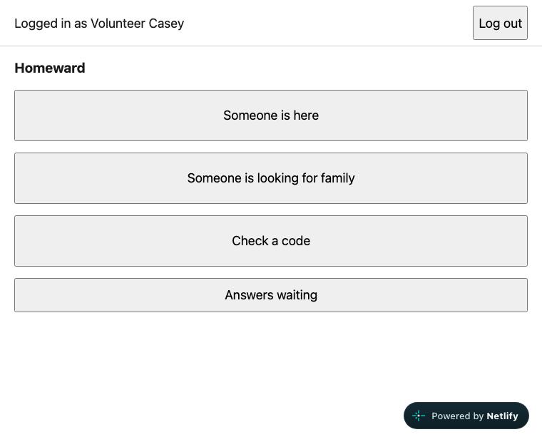
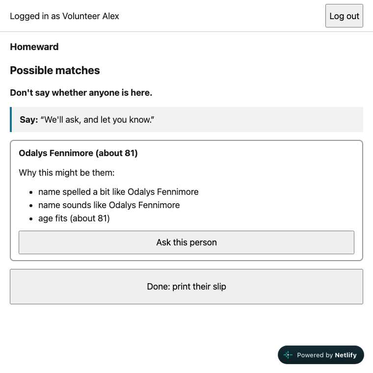
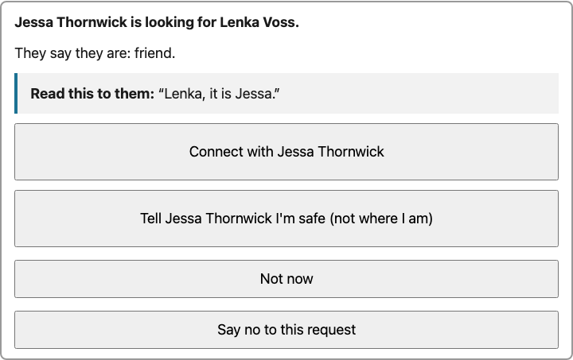
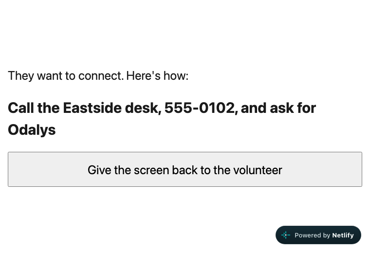

# Homeward user guide

Start with the guide that fits you:

| I'm here as… | Open this |
|---|---|
| A volunteer at the desk | [Volunteer: a full practice from arrival to reunion](VOLUNTEER.md) |
| A lead | [Lead: children, protection and lost slips](LEAD.md) |
| Someone asking for help | [Your choices, your slip and checking for news](PERSON_LOOKING_FOR_HELP.md) |

The original full guide is below. The role guides have fresh screenshots and step-by-step practice. Their screenshots use fictional people in a separate local copy of Homeward 1.0.4; example slip codes do not work on the live demo.

## What Homeward is for

After a hurricane, families end up in different shelters. Many have no phone and no ID.
Homeward lets shelter volunteers register people, look for relatives across all shelters, and pass messages along.
Nobody is told where anyone is unless that person says yes.

**Who uses it**

- **Volunteer.** Works at a shelter desk. Registers people, searches, answers requests, checks slips.
- **Lead.** A volunteer with extra powers: decides about children, protects people, reprints lost slips.
- **The person at the desk** (someone who just arrived, or someone looking for family) never logs in. The volunteer does everything for them. At one moment you turn the screen towards them.

---

## Before you start

- **Link:** https://hilarious-cassata-a51a3c.netlify.app
- **Waiting for the server.** The first visit can take 30 to 60 seconds. You will see **Connecting. Please wait**. Wait. Do not reload again and again.
- **Use a private (incognito) window** when you test. Close it when you finish so nothing stays on the computer.
- Everything here is fictional. Use made-up names only, such as "Pell Ashgrove".

On the login screen, pick your **shelter**, type your **name** and the **PIN** (2468 for everyone), then press **Log in**.

| Shelter | Volunteer | Lead |
|---|---|---|
| Lincoln High Shelter | Volunteer Alex | Lead Jordan |
| Eastside Community Center | Volunteer Riley | Lead Morgan |
| Westfield High Gym | Volunteer Casey | Lead Taylor |

The home screen has four big buttons: **Someone is here**, **Someone is looking for family**, **Check a code** and **Answers waiting**. Leads also see **Lead page: children and safety flags**.
The top bar shows who is logged in and a **Log out** button.

---

## Can we add a volunteer or lead?

**Not through the app yet.** The six logins above are demo accounts made during database setup. There is no staff sign-up, invitation or add-staff page. A lead can handle safety tasks, but cannot add volunteers, promote people or reset staff PINs from the app.

For the demo, use the listed fictional accounts. For a new individual account, the project maintainer must arrange setup outside the app. Do not share a staff PIN or use a survivor's registration form to create a staff account.

A sensible next feature would let a lead add volunteers at their own shelter, while a trusted administrator adds leads. That feature is not built. A coordinator role exists in the code, but this demo has no coordinator account or coordinator dashboard.

## Getting back home

Use **Back to home** when it appears. Otherwise, reopen the [Homeward home link](https://hilarious-cassata-a51a3c.netlify.app) in the same tab after finishing the current task. Save or write down a slip before leaving its screen.

## The 4 everyday jobs

### 1. Someone arrives at your shelter

1. On the home screen press **Someone is here**.
2. Pick **No, the person is here with me**. (For paper forms see below.)
3. Answer one question per screen. Only the name is required. You can leave anything else empty.
   - **What should we call you?** A nickname is fine. Add other names, separated by commas.
   - **About how old are you?** A guess is fine. Then **Under 18**, **18 or over** or **Not sure**.
     If you know the person is an adult, choose **18 or over** (or type an age of 21 or more). With no age and **Not sure**, or a guessed age under 21, Homeward treats them as a child to be safe, and a lead has to approve any "Connect".
   - For a child or "not sure", it also asks **Is an adult from their family with them?**
   - **If someone comes looking for you, what should we do?** Read the "Say:" box aloud. See [the three choices](#what-the-person-can-choose-about-being-found).
   - Optional: where they are from, anything that helps recognise them, a phone number.
4. Check the summary on the last screen (it says "Step 5 of 5") and press **Save**.
5. On the next screen press **Print a slip**. The slip shows a **Code** (like HW-METP) and a **PIN**.
   **The PIN is shown only once.** Print it, or write it down, before you leave the screen.
6. Give the slip to the person. Tell them: any shelter can use it to check for news.

**If you copy paper forms**

1. Pick **Yes, I'm copying paper forms**.
2. Step 1 asks where it is on the paper (for example "Sheet 4, line 12"), the date written on the paper, and a pre-printed slip code if one was handed out.
3. Then go through the same questions and press **Save**.
4. Press **Next person** to carry on with the stack. The paper date stays filled in.
   To switch back to a person at the desk, press **Back** on Step 1.

**If you made a mistake:** press **Fix a mistake**, change it and press **Save changes**.
The slip and PIN stay the same. After you leave the slip screen, a volunteer cannot print the slip again. A lead can (see [Lost slips](#lost-slips-lead)).

### 2. Someone is looking for family

1. Press **Someone is looking for family**.
2. **Who is looking?** Type the name of the person at your desk. Say if they are 18 or over (**Yes** / **No**).
3. **Who are they looking for?** Type one or more names (spelling does not need to be right). Add an age range (**Age from**, **Age to**), how they are related, and where they last saw them.
4. Press **Search**.
5. The screen says **Possible matches**. Each card shows a name, an approximate age and **Why this might be them** (for example "name sounds like", "age fits").
   **Cards never show a place.** Do not say whether anyone is here. Read the "Say:" box: "We'll ask, and let you know."
6. If a card looks right, press **Ask this person**. Write a short message for them (optional). Do not write where you are.
7. Press **Send the request**. The card now says **Asked**.
8. Press **Done: print their slip**, then **Print a slip**. Give the slip to the person looking. They use it to get the answer later.

If nobody matches, you see "No match yet. The search is saved…". Still print the slip. When they come back, use **Check a code**, then open **Their search for … : Check again for new matches** at the shelter where the search was made. On the next page, press **Check again for new matches** to refresh the results, for example after paper forms were typed in.

Looking for **more than one relative**? After the results, press **Look for someone else too**. It is the same person and the same slip, so one slip later shows the answers to all of their searches.

### 3. Someone's family asked about them

The request waits at the shelter where the person is registered.

1. On the home screen press **Answers waiting**. The number in brackets is how many are waiting.
2. Each card says who is looking for whom, how they are related, and **Read this to them**. Read the quote aloud to the person.
3. The person decides. Press one button:
   - **Connect with (name).** You type how they will meet (for example "Call the Eastside desk and ask for Odalys"). The screen shows exactly what will be shared. Press **Yes, share this**.
   - **Tell (searcher) that (name) is safe (not where).** The searcher learns the person is safe. Nothing else.

   - **Not now.** The card stays in the list. Come back later.
   - **Say no to this request.** The card disappears. The searcher is never told "no". They just keep seeing "still looking".
4. After Connect, Safe or No, you see **Answer saved.** With **Not now**, the app says the request is still waiting. If the person chose **Tell them where I am**, the card says so. Staff still handle the contact plan and safety checks.

### 4. Someone has a slip and wants news

This works at **any** shelter, not only the one that printed the slip.

1. Press **Check a code**.
2. Type the code from the slip. The **HW-** part is already there. Use the keys on screen or the keyboard. Codes never contain 0, 1, I or O.
3. Type the **PIN from the slip**. Press **Check**.
4. You see "Slip of (name)." and how many searches were made. Press **Turn the screen around: show the answers**.
5. **Turn the laptop or tablet towards the person.** They read the answer themselves. It is one of:
   - "They want to connect. Here's how: ..." with the meeting plan.
   - "They asked us to tell you they are safe."
   - "Your request is saved. If they choose to connect, we'll let you know here." (This is also what you see for "not now", "no" and "nobody found". It is on purpose.)
6. Press **Give the screen back to the volunteer**. You return to an empty **Check a code** screen.
7. If you pressed **Finished with this person** instead, the screen also resets.

---

## What the person can choose about being found

You ask this question when you register someone. Staff can change it from their existing slip page with **Fix a mistake**. If that page is no longer available, ask for help finding the existing record.

| Option on screen | What it means, in the person's words |
|---|---|
| **Tell them where I am** | "If my family looks for me, you may tell them how to reach me." The volunteer still presses the button. Safety checks still apply. |
| **Ask me first** | "Come to me before you tell anyone anything." This is the usual choice. You see the request and I decide. |
| **Keep me out of searches** | "Don't let anyone find me. Only the shelter staff know I'm here." Even a search with my exact name finds nothing. |

---

## Lead tasks

Log in as a lead and press **Lead page: children and safety flags**. The page has three parts.

### Children

A child is never connected just because a name matches. A lead decides, because a volunteer cannot be sure the adult asking is safe.
A child's request shows on the volunteer's **Answers waiting** with the words "A child is involved, so a lead decides. Please ask a lead." and no buttons.

1. Open **Lead page: children and safety flags**. Look under **Children waiting for a lead**.
2. Follow your shelter's safeguarding process to check the situation in person. A matching name alone is not enough, and the app cannot make this check for you.
3. Tick **I checked the guardian…**. Write a short note under **How you checked**.
4. Tick **The person at this desk agreed in person…** only when that is true. The form requires this box for every release, as well as the guardian check. If the child is the one searching, the adult being asked must agree too.
5. Type **How they will meet**.
6. Press **Check what will be shared**. Read the preview. Press **Yes, release: connect them**.

The same page lists **Children without an adult here**. Press a name to open that child's slip page.

### Protecting someone at risk

Use this when someone says they are in danger from the person looking, or you think so.

1. Open the person's existing slip page at your shelter. You can reach it just after registration, from its saved page address, or by pressing a child's name under **Children without an adult here**. If a code and PIN are still showing, write them down, then press **Fix a mistake** → **Save changes** to return to the lead buttons.
2. Press **Protect this person: never share anything (lead)**, then **Yes, protect them**.
3. The page says "Protected. Nothing about them will be shared." Searches act as if the person is not here.
4. The flag appears under **Safety flags at this shelter** on the lead page. If it is appropriate to remove it, press **Lift this flag**, then **Yes, lift it**. This removes the flag; it does not reconnect an old blocked request. Protection cannot take back details someone already read.

### Lost slips (lead)

1. Open the person's existing slip page (as above). The demo has no general person-list screen. If you cannot reopen the record, ask the project maintainer for help; do not register the person again.
2. Press **Reprint a lost slip (lead)**. Read the warning: the old slip and PIN stop working.
3. Press **Yes, make a new slip**. You get a new **Code** and **PIN**. Print it at once. The PIN is shown only once.

---

## Safety on a shared laptop

- After **10 minutes** without use the screen shows **Screen locked**. Type your PIN and press **Unlock**. You are back where you were.
- When you finish, press **Log out**. Drafts you did not save are cleared.
- The slip PIN disappears once you leave the slip screen.
- After **Give the screen back to the volunteer** the next person sees nothing from the last check.

---

## Try the whole story in 5 minutes

You will play a family reuniting across three shelters. Write down each code and PIN as you go. They are different every time. Log out between steps.

| # | Where | Do this | You should see |
|---|---|---|---|
| 1 | **Eastside**, Volunteer Riley | **Someone is here** > **No, the person is here with me**. Name "Odalys Fennimore", age 80, **18 or over**, **Ask me first**. **Save**, **Print a slip**. | "Odalys Fennimore is saved." A **Code** and **PIN**. (Optional: write it down.) |
| 2 | **Lincoln**, Volunteer Alex | **Someone is looking for family**. Looking: "Pell Ashgrove", **Yes**. For "Odalis Fenimore" (wrong spelling), ages 75 to 85, "mother". **Search**. | One card: Odalys Fennimore, "name sounds like", "age fits". No place. |
| 3 | Same screen | **Ask this person**, message "Mama, it is Pell. I am safe.", **Send the request**. Then **Done: print their slip**, **Print a slip**. Write down **Pell's** code and PIN. | The card says **Asked**. |
| 4 | **Westfield**, Volunteer Casey | **Check a code**. Enter Pell's code and PIN. **Check**. **Turn the screen around: show the answers**. | "Your request is saved. If they choose to connect, we'll let you know here." |
| 5 | **Eastside**, Riley | **Answers waiting**. Find "Pell Ashgrove is looking for Odalys Fennimore." Press **Connect with Pell Ashgrove**. Type "Call the Eastside desk and ask for Odalys". Press **Yes, share this**. | The card disappears. |
| 6 | **Westfield**, Casey | **Check a code** again with Pell's code and PIN. Turn the screen around. | "They want to connect. Here's how: Call the Eastside desk and ask for Odalys". |

Other people may have used the demo before you. **Answers waiting** can hold other cards. Look for your own names.

**Bonus A, a child (3 minutes).** At Eastside register "Tamsin Quillfeather", age 9, **Under 18**, adult with them **No**, **Ask me first**. At Lincoln, search for her as "Bryn Quillfeather", choose **Yes** for 18 or over, and press **Ask this person**. Send the request and print Bryn's slip. At Eastside, Riley sees "A child is involved, so a lead decides" and no buttons. Log in as **Lead Morgan**, open **Lead page: children and safety flags** and do the six child steps. A check of Bryn's slip then shows the meeting plan.

**Bonus B, protection.** As Lead Morgan, register "Dorian Pike". Press **Fix a mistake**, **Save changes**. Press **Protect this person: never share anything (lead)**, **Yes, protect them**. Open the lead page. You see "Never share anything: Dorian Pike". Lift it.

---

## Troubleshooting

**The page says "Connecting. Please wait".**
The server was asleep. Wait up to a minute. If it is still there after two minutes, reload once.

**"That didn't work. Check the shelter, your name and your PIN."**
Check the shelter in the list, type the name exactly as in the table, and use PIN 2468.
After too many tries you may see "Too many tries. Please wait 15 minutes or ask a lead." Wait, or use a **different demo login** (there are six; testing wrong PINs on one account locks only that account).

**"That code and PIN didn't match. Please check the slip and try again."**
Check the code and the PIN against the slip. A wrong code and a wrong PIN give the same message. Too many wrong tries lock that slip for a while. The slip may also have been replaced by a lead (the old one stops working).

**The search found nobody.**
Try another spelling, a nickname, or remove the age range. Hidden or protected people are never found, and you cannot tell that from "not here yet". The search is saved. Give the searcher a slip; when they come back, **Check a code**, then open their saved search at the shelter where it was made. Press **Check again for new matches** on that page to find people registered since.

**A child shows no buttons.**
That is correct. Ask a lead. See [Children](#children).

**I made a typo.**
Press **Fix a mistake** on their slip screen, correct the details, then **Save changes**. Their slip stays the same. If you cannot reopen the existing record, ask for help. Do not register the person again to fix a typo.

**I lost the PIN before printing.**
A lead presses **Reprint a lost slip (lead)**. The old slip stops working.

**I cannot see "Lead page".**
Only leads see it. Log in as a lead (see the table).

**The screen locked.**
Type your PIN and press **Unlock**.
