# I'm a volunteer. Where do I start?

[All guides](USER_GUIDE.md) · [Lead guide](LEAD.md) · [Guide for the person asking for help](PERSON_LOOKING_FOR_HELP.md)

You work at the shelter desk. Someone tells you what they need. You enter it, read out the choices, and let them decide.

This practice uses made-up people. Use fictional details on the demo. The screenshots come from a separate test copy of Homeward 1.0.4, so your lists and slip codes will look different.

## 1. Log in

1. Open [Homeward](https://hilarious-cassata-a51a3c.netlify.app).
2. Choose **Eastside Community Center**.
3. Enter **Volunteer Riley** and demo PIN **2468**.
4. Press **Log in**.

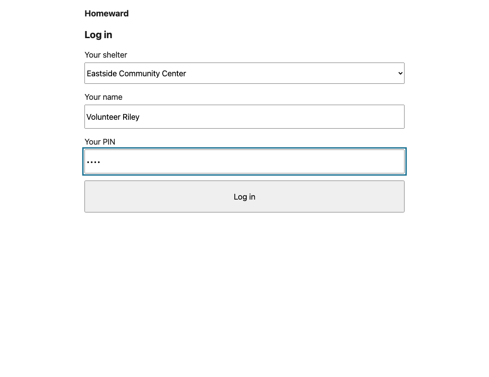

You should see four choices. Pick the one that matches what the person needs.

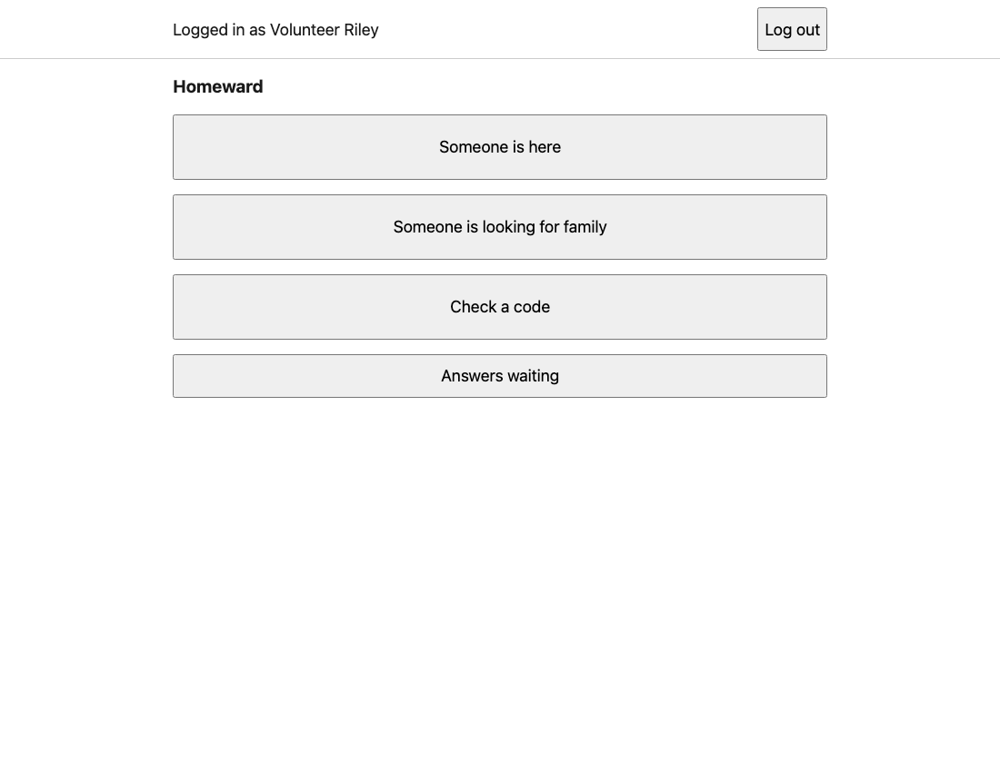

**New volunteer without a login?** There is no sign-up button yet. The demo has six ready-made accounts. See [adding staff](USER_GUIDE.md#can-we-add-a-volunteer-or-lead).

**Getting back home:** use **Back to home** when it is shown. Otherwise, open the [Homeward home link](https://hilarious-cassata-a51a3c.netlify.app) again in the same tab. Do this after finishing the current person and writing down their slip details.

## 2. Someone arrives: register Odalys

Odalys wants her family to be able to ask about her. She wants to decide before anything is shared.

1. Press **Someone is here** → **No, the person is here with me**.
2. Enter **Odalys Fennimore**. Press **Next**.
3. Enter age **80**, choose **18 or over**, then **Next**.
4. Read the privacy question out loud. Leave **Ask me first** selected because that is what Odalys chose. Press **Next**.
5. Leave the extra details empty for this practice. Press **Next**.
6. Check the details, then press **Save**.

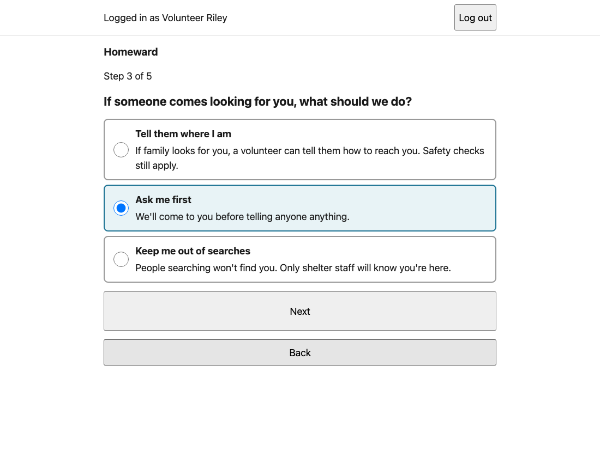

You should see **Odalys Fennimore is saved.** A nickname is enough to register someone. Age and extra details can be unknown. If the app asks whether a child has an adult with them, answer that question too.

7. Press **Print a slip**. Then press **Print**, or write down both the code and PIN before leaving.
8. Give the slip to Odalys. Keep it private. It is for her checks at the desk.

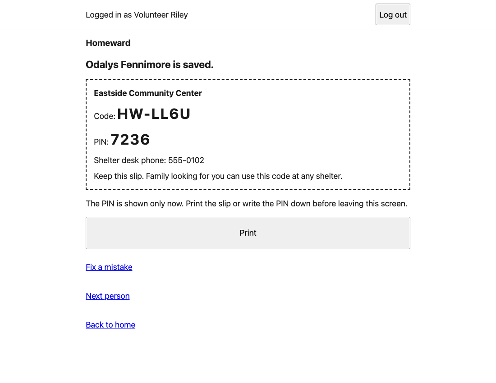

The slip PIN is different from your staff login PIN. It disappears when you leave this screen. The screenshot is just an example; its code will not work on the live demo.

**Made a typo?** While you are on this person's slip page, press **Fix a mistake**, correct it, then **Save changes**. This keeps their existing slip. Don't register them again to fix a typo.

## 3. Their family arrives at another shelter

Now pretend you are the volunteer at Lincoln. Pell is looking for Odalys.

1. Press **Log out**. Log in at **Lincoln High Shelter** as **Volunteer Alex**, PIN **2468**.
2. Press **Someone is looking for family**.
3. Enter **Pell Ashgrove** as the person looking. Choose **Yes** for 18 or over. Press **Next**.
4. Search for **Odalis Fenimore**. The spelling is slightly wrong on purpose.
5. Enter **75** to **85** for the age range. Enter **family** for the relationship. Press **Search**.

You should find Odalys among the possible matches. A similar name is a clue, not proof. Her shelter should not be on the card.

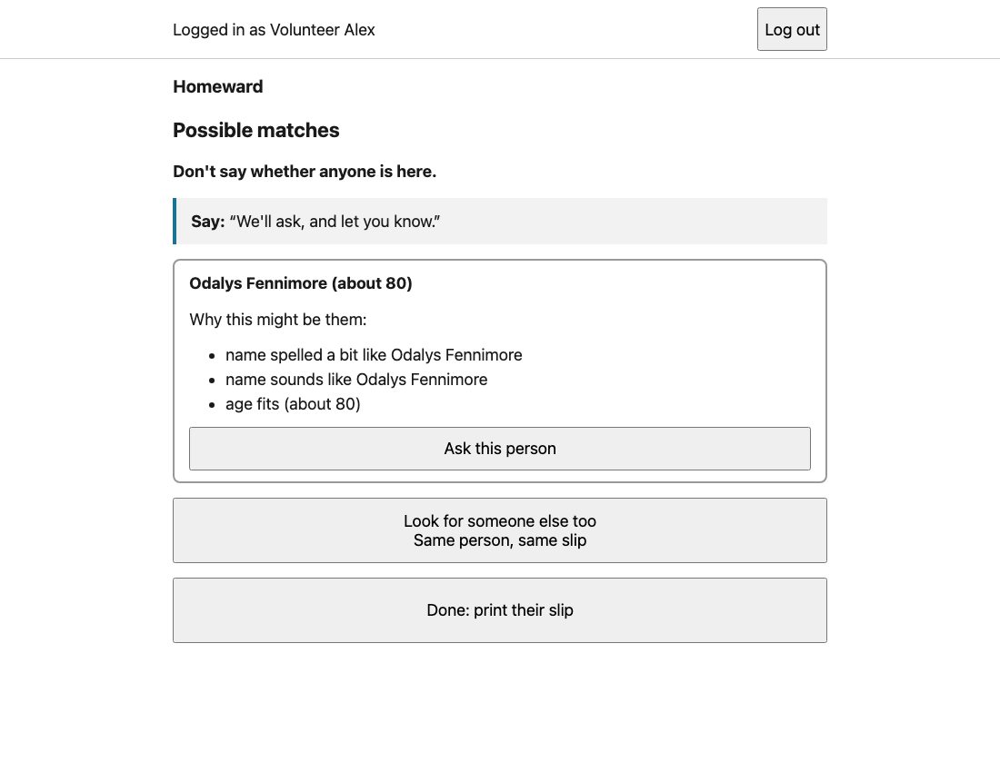

6. On Odalys's card, press **Ask this person**.
7. Enter **Mama, it is Pell. I am safe.** Keep locations out of this message.
8. Press **Send the request**. You should see **Asked**.
9. Press **Done: print their slip**, then **Print a slip**. Print or write down **Pell's** code and PIN.

**Nobody found?** Still give the person their slip. Don't guess why nobody appeared. Hidden people, protected people and people who have not arrived can all look the same.

When they return to the shelter where this search was made: **Check a code** → enter their slip → open **Their search for … : Check again for new matches** → press **Check again for new matches** on that page. This can find someone registered after the first search. You can read answers at other shelters, but refreshing the search needs the original shelter.

**Looking for another relative too?** Before finishing, press **Look for someone else too**. That keeps one person and one slip for their searches.

## 4. Pell comes back with the slip

Try this at a third shelter to see that the slip travels with the person.

1. Log out. Log in at **Westfield High Gym** as **Volunteer Casey**, PIN **2468**.
2. Press **Check a code**. Enter Pell's code and **PIN from the slip**. Press **Check**.
3. You should see **Slip of Pell Ashgrove.**
4. Press **Turn the screen around: show the answers**. Turn the device towards Pell.

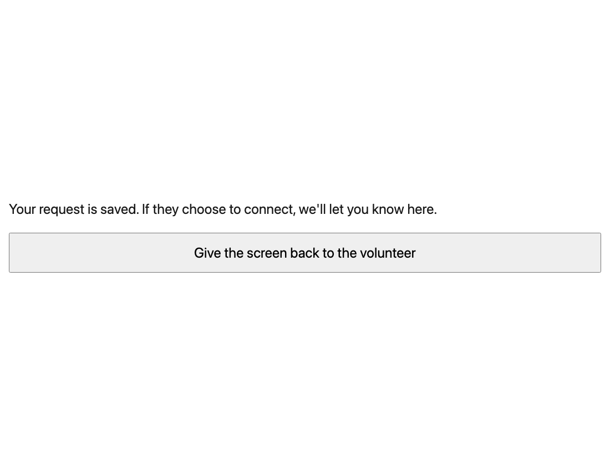

5. Press **Give the screen back to the volunteer** when they finish. The code and PIN boxes should be empty again.

## 5. Odalys decides

1. Log out. Log in as **Volunteer Riley** at **Eastside** again.
2. Open **Answers waiting**. Find **Pell Ashgrove is looking for Odalys Fennimore.**
3. Read the message to Odalys. Ask what she wants to do.

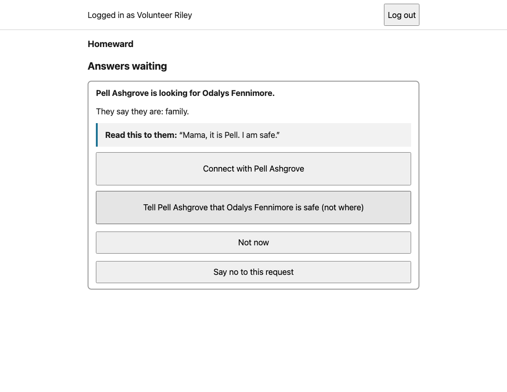

| If Odalys says… | Press… | What Pell gets |
|---|---|---|
| “I want to connect.” | **Connect with Pell Ashgrove** | The contact plan, after you confirm it. |
| “Just tell Pell I'm safe.” | **Tell Pell… safe (not where)** | A short safe message. No location. |
| “I need more time.” | **Not now** | The same waiting message. The card stays. |
| “No.” | **Say no to this request** | The same waiting message. Pell is not told she declined. |

For this story, Odalys chooses to connect:

4. Press **Connect with Pell Ashgrove**.
5. Enter **Call the Eastside desk and ask for Odalys**.
6. Read the preview back to her. If it is what she agreed to share, press **Yes, share this**.

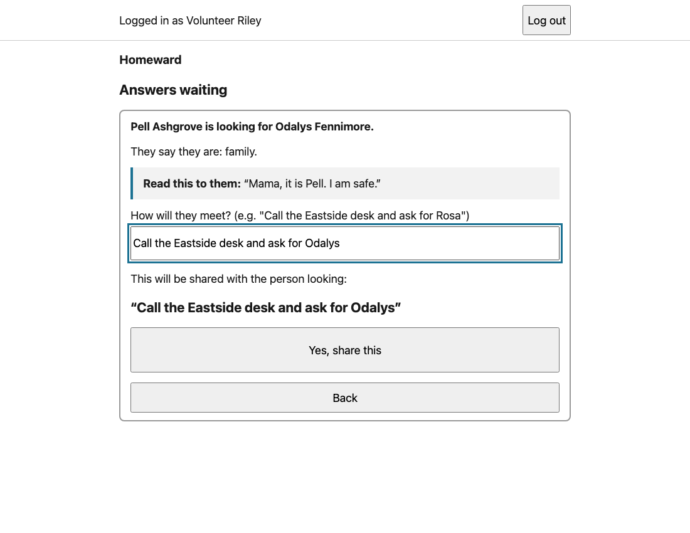

7. Log in as Casey at **Westfield** again. Check Pell's slip and turn the screen around.

You should now see the contact plan.

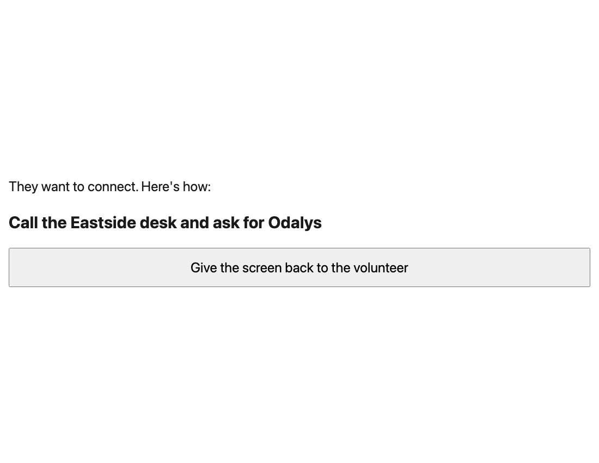

To practice the other answers, start a new fictional searcher and request. For **Not now**, check that the card stays. For **safe** and **no**, check that the request card disappears. Check each searcher's own slip afterward. Use new names so you know which card is yours.

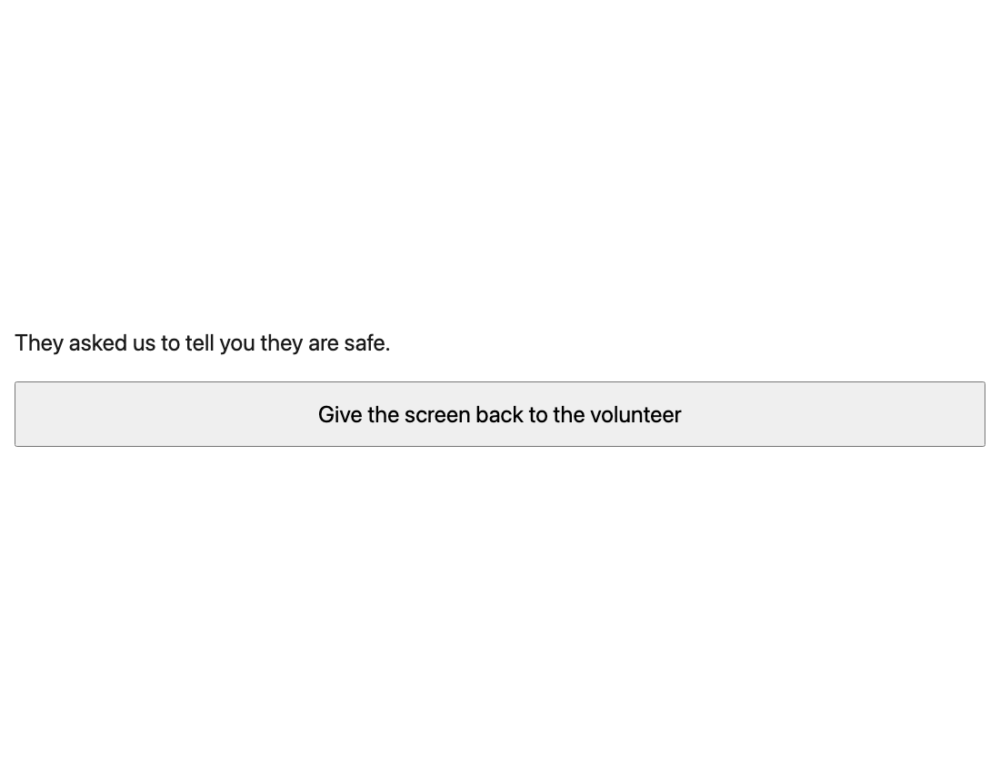

## 6. Copying a paper form

1. At your shelter's home screen, press **Someone is here** → **Yes, I'm copying paper forms**.
2. Enter **Sheet 4, line 12** and the date on the form. If it has no date, use the day the forms were collected.
3. Leave the pre-printed slip code empty unless the form really has one.
4. Press **Next**. For practice, use **Sora Willowbright**, age **42**, **18 or over**, **Ask me first**. Leave extra details empty, check, and save.
5. Print their slip. Press **Next person** to enter the next form.

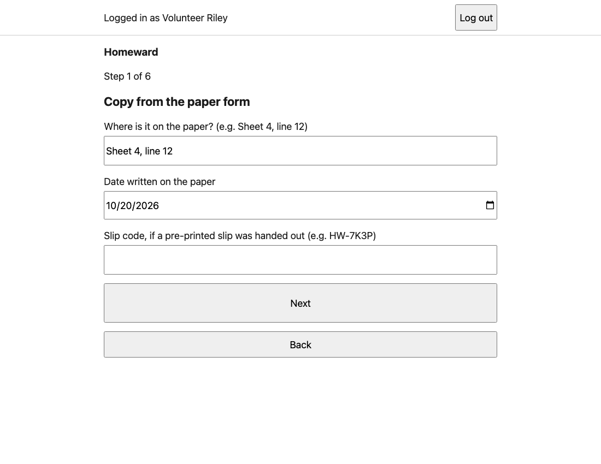

You should see the same date on the next form, with a blank sheet-and-line box. If you want normal intake again, press **Back** from that first paper step and choose **No, the person is here with me**.

## When to get a lead

A child is involved? The answer card says to ask a lead and has no answer buttons. Stop there and ask a lead at the person's shelter. Don't change their age to get past it.

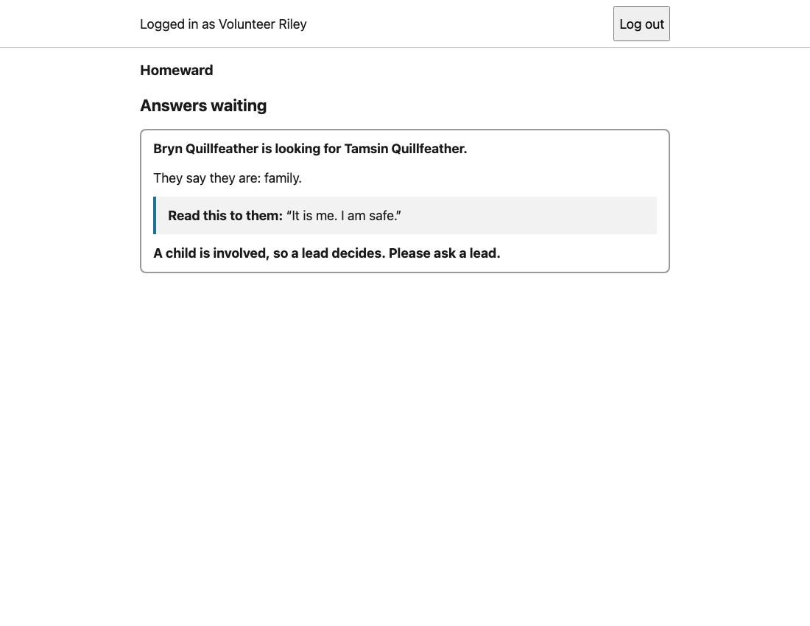

Also ask a lead if someone may be in danger or needs a replacement slip. See the [lead guide](LEAD.md) for the current limits on finding their record again.

At the end of your shift, press **Log out**. Unsaved drafts are cleared when you do.
